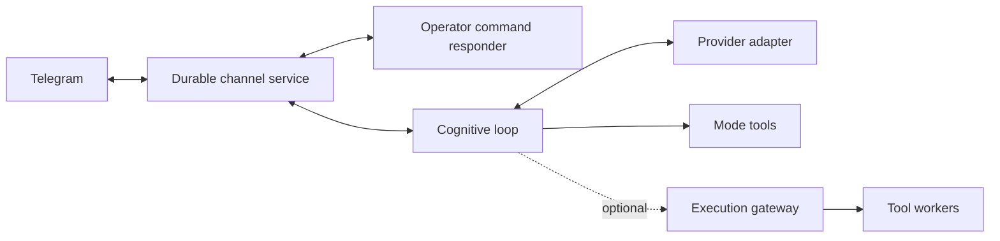

# MeTTaClaw


MeTTaClaw is an extensible agent framework written in MeTTa. It combines
cognitive loops, tool use, communication channels and persistent memory. You
can run your own instance, choose its identity and model, and extend its tools
without tying the framework to a particular bot or operator.

This fork builds on [patham9/mettaclaw](https://github.com/patham9/mettaclaw),
whose compact agent core was inspired by Nanobot. It adds CeTTa execution,
selectable Iter and Omega loops, independent channel controls, and an optional
execution gateway.

**Branch:** this guide describes `integration/upstream-modes-20260930`.
[`main`](https://github.com/godelclaw/mettaclaw/tree/main) contains the earlier
framework; use the branch in the installation command below for these modes.

[Get started](#get-started) · [Modes](#choose-a-cognitive-mode) ·
[Service setup](systemd/README.md) · [Mode internals and verification](modes/README.md) ·
[Execution gateway](src/execution_gateway/README.md)

## Choose a cognitive mode

A **mode** selects the agent's loop; a **model** selects its LLM; an **engine**
selects the MeTTa evaluator. These are independent choices.

| Mode | Behavior |
|---|---|
| `godelclaw` | The framework loop: event-armed activity, persistent lifecycle state and renewal through Iter-inspired transformations. |
| `coding` | The framework loop with a coding-oriented, high-reasoning preset. |
| `iter` | A MeTTa port of the pinned [Iter](https://github.com/patham9/iter) core, with native tool calls, transformations and autonomous renewal. |
| `omega` | The pinned [Omega](https://github.com/singnet/Omega) core, with command-text dispatch and explicit adapters for its evaluator and services. |

Use `/modes` and `/mode iter`, `/mode omega` or `/mode godelclaw` through the
configured operator channel. `/models` and `/model` manage the LLM separately;
`/engines` and `/engine` manage the evaluator. Selection persists across restarts,
and changing a mode requests a supervised restart of cognition. The menu shows
a pending selection separately from the running loop.

Iter and Omega have their own pacing, context handling and mode state. In
particular, Iter can keep renewing work without new human input; the framework's
fuel policy does not automatically impose a quota on upstream modes. Choose a
mode with the intended provider usage in mind. Switching modes preserves each
mode's files without merging its history into another mode.

See the [mode guide](modes/README.md) for upstream pins, provider differences,
compatibility aliases, conformance results and the adapter ledger.

Managed `godelclaw` and `coding` also use a protected request ledger. Accepted
inputs, action reservations and correlated results survive prompt compaction,
interruptions, restart and mode changes. Request preparation applies Iter's
ordered transformations, then attaches protected work and result projections.
The broker checks captured permissions and current input/control revisions
before acting. A result is included before the next dependent model decision.
Effectful batches admit one command; configured higher limits apply to known
independent observations. A script or delegated batch still counts as one
command. Timed command continuations return for reconsideration on waking.

Set `agent.observed_strategy = false` to use the legacy managed host. Standalone
Iter/Omega retain their pinned loops. Existing provider budgets and interruptible
cooldowns remain in force. `nop`, rest and provider prose never establish task
completion in the protected ledger. Completion needs an observed successful
receipt and an operator-registered task checker; exact-output checkers and
explicit operator confirmation are available through `scripts/strategy_ctl.py`.
Natural-language task acceptance and the truth of prose remain host obligations.
An interrupted effect without a saved result stays uncertain and requires
reconciliation; it is not automatically repeated.

Input processing has its own lifecycle: a successful turn, durable history and
durable handover mark a message processed without certifying its requested work.
Agents can retain explicit tasks, wait for the user, defer, address or reopen
work with `request-disposition`; goals retain their checked completion rules.
The working prompt shows eight active headlines and counts. `request-page` and
`request-read` retrieve retained records beyond that view. See the
[request workflow and compact context guide](docs/model-waits/README.md#request-workflow-and-compact-context).

The independent Telegram control responder can acknowledge operator messages
while cognition is waiting. `agent.input_ack_seconds` sets the delay (15 seconds
by default; zero disables it). Notices leave the input pending and use stable
delivery identities to avoid repeated delivery after responder restarts. They
are limited to one notice per lane per minute and require the managed strategy.
Confirmed notices are removed after the corresponding input has a successful
turn and durable history acknowledgement. Failed turns leave the notice in
place. Cleanup persists the service's correlated delivery ID before
acknowledging it; it never guesses an ID or deletes a user message.

Managed input uses `agent.input_policy = "cooperative"` by default. Ordinary
messages queue for the next foreground turn boundary and do not invalidate
an already drafted answer. `/steer ...` queues an explicit correction and
invalidates unexecuted decisions; `/stop` uses the independent lifecycle
responder. Suspended work stays in the ledger. `"legacy"` restores arrival
freshness. `/activity` remains available without waiting for a provider and
reports both foreground work and retained background jobs.

Managed CeTTa also provides named working contexts and read-only concurrent
model jobs. `(topic-select "research")` selects or creates notes;
`(topic-note "...")` replaces them. `(background-model "research" "question")`
starts a separate CeTTa process without blocking the foreground. An optional
third argument is a JSON list of topic dependencies, for example
`(background-model "analysis" "question" "[\"research\"]")`. Each worker
captures notes, dependency revisions and peer job metadata; operator input
remains reachable from every foreground topic. Shared knowledge must be
declared as a dependency to receive a version check.

`(model-jobs)` lists stable job IDs. Read a terminal result with
`(model-result "id")`, then reconsider on the next model step before
`(model-adopt "id")`. Adoption adds the observed evidence view to its original topic once,
provided its owner, control and declared revisions still match. Stale results
remain readable. `(model-retire "id")` releases retained capacity after
observation, without erasing evidence or refunding provider work.
Long results have a bounded excerpt, length, digest and truncation flag. The
complete result stays in the checkpoint; adoption copies the displayed
excerpt with its source reference, never its unseen remainder.
`(command-receipts)` exposes attempted commands and their recorded outcomes.
Provider prose cannot grant observation, completion or tool authority.

`agent.background_models` defaults to one retained background call (zero
disables admission; maximum eight). `agent.background_tokens` defaults to
1024. These workers share provider limits and service allowance with the
foreground. They return text only; the foreground broker owns tools and
messages. Restart keeps an unfinished POST uncertain rather than repeating
it. This is concurrent process execution, with a serialized effect broker.

`(requests)`, `(request-status "id")` and `(request-focus "id")` expose retained
work. Search results without exhaustive, revision-matched coverage explicitly
leave absence unproved. Large result projections include a truncation flag and
digest; the full receipt remains in the instance's SQLite ledger.

Grouped deployments use `scripts/update_instances.py --plan deployment.json
--release release-directory --receipt-dir update-receipts --apply`. Keep the
deployment plan private. It supplies separate instance directories, service
names, expected old hashes, instance overlays and offline checks. The updater
holds cognitive launchers, stages the same manifest into every instance, checks
all of them, then activates them together. Backups and per-instance release
receipts make failed qualification and rollback reviewable. Optional
`control_services` per instance adds independent command responders to the
same activation and rollback. They restart only after the whole group passes
qualification, while cognitive launchers remain held.
Optional
`required_runtime` settings are checked against the running process, including
the strategy flag and selected transport. Rollback also uses ordinary turn
boundaries; a stuck candidate remains held pending recovery. Instance additions
belong in `src/instance_hooks.metta`, which shared releases preserve.

Runtime checks: `python3 -m unittest tests.test_observed_strategy
tests.test_strategy_host tests.test_update_instances tests.test_managed_strategy_runtime`.
The thirteen durable checkpoints can also be compared with MeTTapedia's
executable model using `scripts/check_host_strategy.py --help`. These are model
laws and tested runtime correspondence, not a proof of the C/Python runtime.

Weighted goal scheduling is opt-in with `agent.fair_goals = true`. Definitions
remain in `memory/goals.metta`; service counters and cycle receipts live in the
same SQLite checkpoint as protected requests. For example:

```metta
(goal investigate Research sti:0.5 lti:0.5 vibes:() blocked-by:none last-verified:never note:"Inspect the current evidence")
(goal review Maintenance sti:0.5 lti:0.5 vibes:() blocked-by:none last-verified:never note:"Review the goal inventory and record next steps")
(goal-policy investigate share:2 every:once urgency:0 checker:operator)
(goal-policy review share:1 every:86400 urgency:10 checker:inventory-review)
```

The eligible goal with least service/share receives the next autonomous
provider attempt; age and urgency break ties. Integer cross-products preserve
exact ratios. Zero share disables autonomous scheduling. Incoming input takes
precedence. Budget denial adds no service; admitted failures keep their charge.
Foreground continuation steps keep their request until the existing loop policy
opens an autonomous opportunity; absence of a new message is not such a boundary.
Completion, restart, compaction and mode changes do not erase accounting.
New recurring goals start due; completing a cycle starts its configured wait.

`(goals)` includes the inventory digest. `(help "goal-review-save")` describes
the structured review artifact. Its checker requires coverage of that exact
inventory and an observed, correlated result. It certifies a recorded review,
not the truth of the assessments or completion of the reviewed work. Review
is scheduled through the same queue as other goals. Removing or disabling a
goal never completes its protected request.
The latest completed review accompanies the selected goal's next turn, with
an explicit indication of whether its source definition has since changed.

`python3 -m unittest tests.test_fair_goals` checks the runtime adapter.
`scripts/audit_fair_goals.py --ledger STATE/observed-strategy.sqlite3
--lean-output Decisions.lean` checks durable accounting and exports numeric
decisions for independent replay against MeTTapedia's `FairGoalScheduling`.
Run the emitted file with the qualified model on `LEAN_PATH`; export alone is
not a Lean verdict. New goals join at the current service floor; reweighting
starts a new share epoch. Bounded-wait proofs apply to finite stable cohorts
with continued admitted opportunities, not unlimited arrivals or wall time.
This is weighted virtual service, not Linux's complete EEVDF algorithm.
Existing provider budgets, wake policies and strict upstream modes are unchanged.

For recorded live safety, `scripts/audit_strategy.py --help` reads each supplied
ledger in a read-only transaction, maps identities without exporting message or
result text, and checks the event trace and final saved state with MeTTapedia's
`StrategyTraceAudit.lean`. It checks captured authority, recorded revisions,
reservation/result ordering, observation barriers and checked completion.
Its receipt separates safety violations from unresolved effects. Run it from
an independent operator process; it neither wakes nor changes an instance.
Task-checker truth, external-effect delivery, clock/budget enforcement and useful
progress require their own evidence and are outside this trace audit.

## Get started

You need Python 3.11+, [SWI-Prolog](https://www.swi-prolog.org/) and a working
[PeTTa checkout](https://github.com/trueagi-io/PeTTa) with its Python bridge.
Install this repository's Python dependencies in the environment that bridge
uses. For CeTTa execution, also provide a built
[CeTTa](https://github.com/godelclaw/CeTTa) with `--lang petta` and its matching
`lib/` directory. The [qualified revisions](modes/README.md#pins-and-review-locations)
record the versions used for the mode checks.

### 1. Clone and initialize

```sh
git clone --branch integration/upstream-modes-20260930 \
  https://github.com/godelclaw/mettaclaw.git
cd mettaclaw
./initialize.sh
```

Initialization creates local configuration and seeds the runtime files. It does
not start an agent or register a Telegram bot.

### 2. Configure your instance

| File | What to configure |
|---|---|
| `config/local.toml` | Evaluator paths, Python environment, provider endpoint/model, channel and storage locations. Seeded from [the defaults](config/default.toml). |
| `config/secrets.env` | Provider credentials, bot token, operator IDs and allowed chats. See [the field examples](config/secrets.env.example). |
| `memory/prompt.txt` | Your agent's identity, goals and operating instructions. Initialization seeds the reusable [default prompt](identity/default-prompt.txt); customize your private copy. |
| `.env` | Generated settings; startup regenerates this file from `config/local.toml`. |

Use the configuration command to inspect, validate or change a nonsecret
setting while preserving the other settings:

```bash
python3 scripts/config_ctl.py check
python3 scripts/config_ctl.py get agent.llm_timeout_seconds
python3 scripts/config_ctl.py --dry-run set agent.llm_timeout_seconds 300
python3 scripts/config_ctl.py set agent.llm_timeout_seconds 300
```

The command returns JSON, serializes concurrent edits, validates before writing,
and replaces each file atomically. It writes the authoritative TOML first and
then generates `.env`; startup regenerates `.env` even when initialization is
skipped. Existing processes adopt settings at their next normal restart. Keys
absent from the default configuration and credential fields are rejected;
credentials stay in `config/secrets.env`. Direct TOML edits can be validated
with `check` and applied to the generated file with `render`.

Set `paths.petta_root`, `paths.petta_py_env` and, if used, `paths.cetta_root` to
your installations. The default provider adapter uses an OpenAI-compatible
endpoint via `agent.synthetic_base_url`, `agent.synthetic_model` and
`SYNTHETIC_API_KEY`. The Anthropic adapter uses `ANTHROPIC_API_KEY`; its selectable
model list can be supplied through `ANTHROPIC_MODELS`.

Telegram requires your own bot token and explicit operator/chat authorization.
For its default private destination, configure
`METTACLAW_TELEGRAM_PRIMARY_CHAT_ID`. The framework also has IRC and Mattermost
adapters; the supplied Iter/Omega integration currently requires the independent
durable Telegram services described below.

Configuration, credentials, conversations and runtime state are ignored by Git.
Keep each instance's files separate. Public prompts and examples belong in the
source tree only when they are intended for reuse.

The managed default prompt combines Iter's attention to unresolved requests
with Omega's goal and memory discipline, using the managed runtime's
observe-before-deciding policy. It contains no operator identity, chat IDs,
credentials or deployment paths. Initialization preserves an existing private
prompt unless explicitly forced. The pinned standalone Iter/Omega prompts
remain unchanged; their own protocols and pacing belong to those modes.

### 3. Install dependencies and check imports

After editing the configuration, regenerate it and use the configured Python
interpreter:

```sh
./initialize.sh
set -a
. ./.env
set +a
"$PETTA_PY_ENV/bin/python3" -m pip install -r requirements.txt
./run.sh smoketest.metta
```

The smoke check imports the library and exits without starting the cognitive
loop. It can fetch the `petta_lib_chromadb` dependency into `repos/` on its first
run. Embedding-backed memory needs additional configuration; see
[Memory](#memory).

### 4. Run the framework or set up supervised modes

For the default framework loop, launch from your configured checkout:

```sh
./run.sh
```

For Iter/Omega, set up the durable channel and independent command responder
first, then supervise cognition so mode changes can restart it. Follow the
[service setup guide](systemd/README.md). These channel/control services use
CeTTa even when the selected cognitive evaluator is PeTTa.

For automatic startup after reboot, install and enable the cognition, socket,
transport and command-responder units, then enable user lingering if they must
start before interactive login. The [boot and recovery checks](systemd/README.md#start-at-boot-and-check-recovery)
also distinguish a running process from successful provider and input handling.

Use one checkout/configuration and one set of state directories and sockets per
instance. Names such as `research` and `assistant` are examples you choose, not
identities built into the cognitive modes. Some older named service files and
the peer-control helper are deployment-specific; the service guide distinguishes
them from the reusable templates.

## Services and execution



The durable channel owns Telegram polling, delivery and recovery. The independent
command responder handles operator settings without an LLM call, so changing a
mode or inspecting health does not wait for a cognitive turn. Message adapters
retain sender, chat, thread, reply and forwarding metadata. Group destinations
are explicit; reading a group message does not change the default send target.

CeTTa's [durable MeTTa/rho service host](https://github.com/godelclaw/CeTTa/blob/9a5355309c57d94e99e5a279e088b69cbe4486d8/docs/durable/README.md)
records inputs, proposed effects and delivery receipts at its commit boundary.
The channel clients use its CWP socket protocol. Accepting a send request is
distinct from confirming delivery; uncertain effects remain available for
reconciliation.

The optional [execution gateway](src/execution_gateway/README.md) runs tool
workers in a separate process with a SQLite queue and receipts. The current
integration exposes a small set of read tools. Provider calls and other tools
retain their own adapters; the gateway is not a universal execution path.
Its prototype transport is JSON over Unix sockets, with no native rho bridge
qualified yet. Each instance uses its own gateway configuration and queue.

The provider client has two transports behind the same conversation boundary.
Set `METTACLAW_LLM_TRANSPORT=native` on an HTTP-enabled CeTTa Python build to
use [`native_llm.metta`](src/native_llm.metta): CeTTa submits one asynchronous
request, and CeTTa's shared `llm`, `llm:command`, `llm:compat` and `llm:io`
libraries construct requests and decode Chat Completions, Anthropic Messages or
OpenAI Responses. This requires the versioned `llm:v1:` API and owner-selected
`io:wait`, progress observations and independent HTTP timeout settings in the
chosen CeTTa build. SWI-PeTTa retains the Python HTTP adapter.
Python owns provider/model selection, upstream prompt splitting, cache identity,
credential scope and the admission ledger; this is not yet a Python-free deployment.

The native library preserves ordered items and parts, call IDs, optional usage,
raw completion reasons and native reasoning attachments. Imported modes still
receive their existing chat projection or command text; those formats separate
text, reasoning and tools and lose some ordering and metadata. The structured
host result also exposes the complete `llm_result`, but mode histories have not
been converted to lossless native replay. Anthropic effort is sent through
`output_config`; its signed reasoning blocks are kept for the next tool turn.
Anthropic system blocks use ephemeral caching; OpenAI Responses uses a stable
prompt cache key. A truncated command-text reply is recorded as a failed turn
and is not executed. A truncated or unfinished tool batch is rejected before
the imported loop can dispatch it. Iter retains its upstream structured-call
protocol. Command wire layouts and compatible-provider reasoning options remain
explicit compatibility policies rather than defaults of the generic codec.

Each native plan has one local submission authority and a session epoch.
Waiting consumes only its own HTTP handle; unrelated completions remain queued.
Terminal observations cannot trigger another request. Cancellation and timeout
still do not prove that the remote provider did no work. The library does not
retry requests or execute tools. Chat Completions streaming is assembled into a
complete, validated result before publication; partial text and tools do not
authorize actions. A soft wait retains the original call, while connection,
initial silence, subsequent silence and an absolute transport backstop have
separate limits. Read-only topic workers and the independent controls can
continue while the foreground waits. See the
[model request lifetime guide](docs/model-waits/README.md) for configuration,
bounded late evidence, recovery and offline checks.

Native requests carry `(http:credential "ALIAS")`, never a bearer token atom.
The host authorizes the alias through `CETTA_IO_AUTH_<ALIAS>_URL_PREFIX`,
`_HEADER`, `_ENV` and `_PREFIX`. The native worker resolves the environment-owned
key for that scope, refuses credential redirects and duplicate credential
headers, and blocks a response containing the key. The client configures these
aliases from the chosen provider; custom aliases require host configuration.
The native soft wait defaults to 120 seconds, with a 1,800-second hard backstop.
Streaming has an 8 MiB response bound; buffered responses retain the 1 MiB bound.
Configure these through `config/local.toml`; `METTACLAW_LLM_RESPONSE_BYTES`
provides a checked response-size override.
The transport byte cap is not a guarantee that the JSON codec accepts every
body below it. Parser work and depth limits can reject a smaller body; these
remain an explicit qualification limit for large contexts and replies.

### Operator admission and upstream profiles

For feedback after each action in the managed `godelclaw` and `coding` loops,
set `command_batch_limit = 1` under `[agent]` in `config/local.toml`.
The configured default is five; the protected strategy restricts effectful
batches to one and permits higher limits only for independent observations.
`METTACLAW_COMMAND_BATCH_LIMIT` configures the same limit
when no local value is set. The prompt and dispatcher use the same positive
limit. Excess commands are recorded as deferred for reconsideration after the
executed result; they are not automatically replayed. One command may contain
a multi-step script or delegated tool batch. This setting leaves the vendored
Iter and Omega dispatch protocols unchanged.

The admission ledger is shared across an instance's modes, while each mode
retains its own cognitive state. It does not rewrite energy, fuel, prompts,
transformations or the mode's pacing algorithm. Repository defaults add no
request or token cap: Iter/Omega use `upstream`, other modes use `managed` with
caps disabled. Select `METTACLAW_LLM_POLICY=managed` for an integrated deployment
or `upstream` to bypass added admission limits and cooldowns. The original
vendored sources and standalone conformance runners remain available.

`METTACLAW_LLM_POLICY_PATH` optionally names a JSON file. Zero disables a cap;
these defaults preserve existing framework fuel policies:

```json
{
  "requests_per_hour": 0,
  "output_tokens_per_day": 0,
  "failures_per_window": 0,
  "failure_window_seconds": 300,
  "quota_cooldown_seconds": 300
}
```

Add `profile` or per-mode overrides under `modes` when needed. Every numeric
setting also has a `METTACLAW_LLM_<UPPERCASE_NAME>` environment override. The
metadata-only SQLite ledger reserves a request's maximum output before sending;
an uncertain timeout retains that reservation, and known usage settles it once.
Daily output caps use UTC days; request and failure caps use rolling windows.
Managed quota failures establish a provider cooldown across mode changes.
Existing framework backoff remains interruptible. Limits apply per instance,
not across separate instances sharing a provider account.

The executable [Lean model in MeTTapedia](https://github.com/godelclaw/MeTTapedia/blob/main/lean/pettaclaw/LlmBoundary.lean)
proves selected completion, queue ownership, ordered replay, tool readiness and
admission laws under explicit host assumptions.
It does not verify the external provider or the complete C/Python implementation.
Offline checks include provider wire fixtures, native credentials, signed tool
batches, slow requests, duplicate/foreign events, truncation and both evaluators:

```sh
python3 -m unittest discover -s tests -p 'test_provider_protocol.py'
python3 -m unittest discover -s tests -p 'test_llm_policy.py'
CETTA_BIN=/path/to/cetta python3 -m unittest discover -s tests -p 'test_native_llm_boundary.py'
MODE_TEST_CETTA_BIN=/path/to/engine-bundle/cetta python3 -m unittest discover -s tests -p 'test_upstream_mode_runtime.py'
```

Run native checks with the Python environment used to build CeTTa.

## Memory

The framework exposes `(remember string)` and `(query string)` for deliberate
long-term memory use. Remembered items are journaled under `memory/remembered/`;
Chroma holds the derived similarity index. The agent can use different MeTTa
representations within those memories.

Embedding-backed recall uses the configured Qwen-compatible embedding service.
The launcher defaults to `http://127.0.0.1:8876`; the service itself is not
installed by this repository. Configure `METTACLAW_EMBED_ENDPOINT` and the
matching model/protocol before using these skills. The
[journal replay utility](scripts/rebuild_chroma_from_journal.py) can build and
verify a separate Chroma index; run it with `--help` for its explicit inputs.

Upstream modes keep their own memory behavior: Iter retains its experience and
transformations; the Omega host currently provides text recall with its embedding,
NAL/PLN and plugin startup add-ons disabled. The [adapter ledger](modes/README.md#divergence-and-add-on-ledger)
details these boundaries.

## Verification and development

Small checks that use fixtures instead of a live provider:

```sh
python3 -m unittest discover -s tests -p test_loop_modes.py
python3 -m unittest discover -s tests -p test_mode_control_boundary.py
python3 -m unittest discover -s tests -p test_public_tree_audit.py
```

The [offline qualification command](modes/README.md#exact-offline-verification-command)
compares pinned upstream references with CeTTa execution, checks deliberate
semantic mutants, runs relevant upstream tests and replays observations against
Lean models. It requires the pinned evaluator and formalization checkouts.
Those models prove selected control properties with explicit host assumptions;
they do not establish correctness of every provider, tool or operating system.

To contribute, keep changes focused and include the relevant fixture or test
command. Changes to a vendored core should update its source pin, manifest and
adapter ledger together. Keep provider credentials and runtime state local.
Before publishing from an authoring clone, enable the existing audit hook:

```sh
git config core.hooksPath .githooks
python3 scripts/audit_public_tree.py --history
```

The audit checks tracked runtime paths and locally configured private values.
It complements review of the actual diff; it does not infer whether a deployment
story is appropriate public documentation.

## Illustrations

The upstream examples show memory recall, tool use and learning in a grid-world
adapted from [NACE](https://github.com/patham9/NACE).


Long-Term Memory Recall:


Tool use:


Shell output of the actual invocation of the generated MeTTa code:


System also added it into its Atom Space storage (embedding vector omitted):


## Proposal-bound self-modification

The file tools create immutable proposals instead of rewriting the running
agent. A proposal contains the exact candidate bytes, their SHA-256 digest,
the prior target digest, and provenance. MeTTa candidates are parsed by PeTTa's
`top_forms` and `sread` without calling `process_form`. Optional semantic
evaluation runs directly with the agent process's authority; it is validation,
not a sandbox, and may perform effects present in the candidate.

Promotion is a separate, explicit operation. Digest binding, stale-base checks,
and atomic replacement prevent an unverified proposal from being confused with
the promoted candidate:

```sh
python3 scripts/selfmod_supervisor.py verify PROPOSAL_ID \
  --root PROTECTED_ROOT --store PROPOSAL_STORE
python3 scripts/selfmod_supervisor.py promote PROPOSAL_ID \
  --root PROTECTED_ROOT --store PROPOSAL_STORE
```

Add `--semantic` to require direct PeTTa evaluation. Configure locations
with `METTACLAW_PROTECTED_ROOT`, `METTACLAW_SELFMOD_PROPOSAL_STORE`, and
`PETTA_ROOT`. Optional external governance is enabled only when
`METTACLAW_SELFMOD_REQUIRE_GOVERNANCE=1`; its executable is supplied through
`METTACLAW_GGB_SELFMOD_CLI`.

## Runtime observations in managed context

The managed strategy adds one bounded `RUNTIME_STATE` packet after replaceable
request transformations. It reports recorded provider/retry state, pending
turn settlement, local channel readiness, operator inputs awaiting processing,
recent command receipt counts and reasons, persisted memory-index sequence
gap, and owned model results awaiting review. Budget numbers appear at a cap.
The packet is limited to 2,400 characters; full details remain available through
`vitals`, `command-receipts`, `model-jobs` and `llm-quota`.

Missing, malformed, stale or unsupported readings remain explicitly unknown.
Local channel readiness does not establish remote network reachability. Inbox
ages use message timestamps in the last complete service scan; processing is
distinct from answering. Failed or truncated scans remain unknown. A persisted
index sequence gap is distinct from a count of missing memories. Receipt counts
describe a recent bounded window, including records covering command batches.
Returned provider or command data does not prove task completion.

These observations grant no tool authority and acknowledge no messages or
receipts. The captured packet must survive preparation before provider
admission. Strict standalone Iter/Omega profiles retain their existing context.

## Credits and license

This fork builds on [patham9/mettaclaw](https://github.com/patham9/mettaclaw).
Zar is the lead human contributor to this fork; Oruži is the collective
attribution for collaborating AI agents. The Git history retains authorship
and the progression of the work.

Iter and Omega retain their upstream licenses and exact source manifests under
[`modes/`](modes/README.md). See [LICENSE](LICENSE) for this repository's license.
