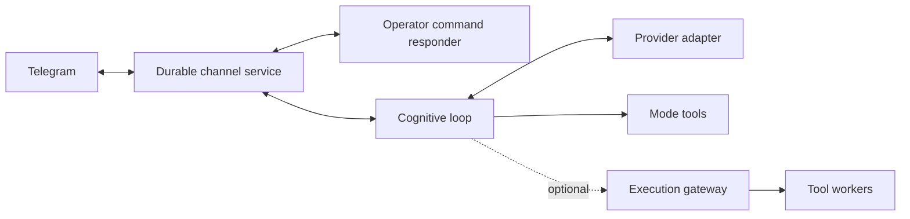

# GödelClaw


GödelClaw is an extensible agent framework written in MeTTa. It combines
cognitive loops, tool use, communication channels and persistent memory. You
can run your own instance, choose its identity and model, and extend its tools
without tying the framework to a particular bot or operator.

This fork builds on [patham9/mettaclaw](https://github.com/patham9/mettaclaw),
whose compact agent core was inspired by Nanobot. It adds CeTTa execution,
selectable Iter and Omega loops, independent channel controls, and an optional
execution gateway.

`main` is the tested, shareable runtime. The matching CeTTa source is pinned
in [CETTA_REF](CETTA_REF) and published on
[godelclaw/CeTTa, branch cetta-ours](https://github.com/godelclaw/CeTTa/tree/cetta-ours).
The installer and container build read that same pin.

[Get started](#get-started) · [Modes](#choose-a-cognitive-mode) ·
[Service setup](systemd/README.md) · [Mode internals and verification](modes/README.md) ·
[Execution gateway](src/execution_gateway/README.md)

## Run ITER or Omega at a terminal

These launch paths need a Python-enabled [CeTTa](https://github.com/godelclaw/CeTTa)
bundle and the selected mode's small dependency file. They do not require
Telegram, a service installation, or the framework's full `requirements.txt`.
Use a Python environment matching the Python version linked into CeTTa
(`BUILD=python`); virtual environments are supported.

```sh
git clone https://github.com/godelclaw/godelclaw.git
cd godelclaw
python3 scripts/build_cetta.py
export CETTA_BIN="$PWD/.runtime/cetta/cetta"
python3 -m pip install -r modes/iter/requirements.txt
./run.sh --mode iter
```

ITER uses upstream's `LLM_MODEL`, `BASE_URL`, and `AI_API_KEY` variables and
their pinned defaults. Set them to your model endpoint before starting. It
keeps upstream's prompt, tools, transformations and context policy. Input and
replies use the terminal; worker sends are forwarded to the foreground.

Omega's standalone **core** uses upstream's provider SDK and `OMEGA_*`
configuration, with terminal I/O, history and text recall. Its embedding,
NAL/PLN and optional plugin startup are omitted; this profile does not run
the entire Omega distribution. For an OpenAI-compatible local endpoint:

```sh
python3 -m pip install -r modes/omega/requirements.txt
OMEGA_provider=OpenAIAPI OMEGA_model=your-model \
OMEGA_openaiapi_url=http://localhost:11434/v1 OPENAIAPI_API_KEY=dummy \
  ./run.sh --mode omega
```

The default Omega provider and model remain those of the pinned source.
No framework identity or instance configuration is loaded by these commands.
State persists under `$XDG_STATE_HOME/mettaclaw/<checkout-name>/standalone`
(or the usual user state directory). `--state-dir ./my-state` selects another
location; `--prompt ./my-prompt.txt` adds instructions when creating new state.
Ctrl-C stops the foreground launch. See [mode details](modes/README.md#standalone-terminal-launches)
for scope, supported providers and verification.

## Choose a cognitive mode

### Container quick start

The container bundles the same pinned CeTTa engine and services. Its terminal
entrypoint runs Iter or Omega core, as described above, under an unprivileged
account. Supply your provider configuration at runtime and retain state on a
volume:

```sh
docker build -t godelclaw .
docker run --rm -it --env-file provider.env -v godelclaw-state:/state godelclaw iter
docker run --rm -it --env-file provider.env -v omega-state:/state godelclaw omega
```

For Iter, `provider.env` contains `LLM_MODEL`, `BASE_URL` and `AI_API_KEY`.
For Omega, use its `OMEGA_*` settings and the selected provider's key, shown
above. Each mode retains separate state. Pass `--state-dir /state/another-agent`
after the mode name for another identity. Credentials and live state are outside
the image. The framework's Telegram deployment uses the [service setup](systemd/README.md)
and full runtime dependencies; the terminal container does not start it.

A **mode** selects the agent's loop; a **model** selects its LLM; an **engine**
selects the MeTTa evaluator. These are independent choices.

| Mode | Behavior |
|---|---|
| `godelclaw` | The framework loop: event-armed activity, persistent lifecycle state and renewal through Iter-inspired transformations. |
| `coding` | The framework loop with a coding-oriented, high-reasoning preset. |
| `iter` | A MeTTa port of the pinned [Iter](https://github.com/patham9/iter) core, with native tool calls, transformations and autonomous renewal. |
| `omega` | The pinned [Omega](https://github.com/singnet/Omega) core, with command-text dispatch and explicit adapters for its evaluator and services. |

Use `/modes` and `/mode iter`, `/mode omega` or `/mode godelclaw` through the
configured operator channel. `/models` and `/model` manage the LLM separately;
`/engines` and `/engine` manage the evaluator. Selection persists across restarts,
and changing a mode requests a supervised restart of cognition. The menu shows
a pending selection separately from the running loop.

Iter and Omega have their own pacing, context handling and mode state. In
particular, Iter can keep renewing work without new human input; the framework's
fuel policy does not automatically impose a quota on upstream modes. Choose a
mode with the intended provider usage in mind. Switching modes preserves each
mode's files without merging its history into another mode.

See the [mode guide](modes/README.md) for upstream pins, provider differences,
compatibility aliases, conformance results and the adapter ledger.

The task transcript carries the originating request, later input, ordered tool
calls and their results. A continued task keeps its earlier evidence across
turns and restarts. New chat input adds conversation context; continued work
emphasizes the task history. `(task-history "task-id")`, `(task-read "record-id"
0)` and `(request-read "request-id" 0)` recover original evidence.

The dispatcher executes emitted commands in order and records a result for each.
A failed read, unknown tool, changed goal, new message, or bookkeeping update does
not discard later commands. `/stop` interrupts unexecuted work. The model chooses
which decisions require another observation; the host does not guess dependencies.
Interrupted actions retain an explicit unknown outcome and are not automatically
replayed. They do not prevent fresh work.

`(context-policy)` shows the task context target. `(context-policy 65536)` changes
it and persists the choice. The default is 32,768 estimated tokens, within the
selected model's remaining capacity. Estimates are calibrated against provider
usage separately for each model. Older call/result pairs remain on disk with
retrieval pointers. Compaction does not mark work complete. Notes are optional
working aids; there is no pending-command or resolution chore.

`(topic-select "research")` and `(topic-note "...")` retain named notes. Historical
background model results remain readable with `model-jobs` and `model-result`;
the unused background execution and adoption machinery has been removed.

The agent chooses its next goal. `(goal-retire "name" "reason")` records retirement
separately from achievement and preserves it across restart. A delivered answer
settles an unambiguously corresponding arrival automatically and resumes its waiting parent;
this is conversation workflow, not proof that the underlying task was achieved.
Replies do not settle unrelated arrivals combined in the same request.

`(rest 60 (shell "printf ready"))` schedules the command without a model call.
The quoted form `(rest 60 (quote (shell "printf ready")))` remains accepted.
`(rest 60 "review the result")` retains a note for the next waking. Rest banks
remaining burst energy. Timers survive restart; an action interrupted while
running is reported as unknown and is not replayed. The life heartbeat can wake
without prematurely firing a later timer.

## Get started

For CeTTa, install Python 3.11+, GCC, Make, `pkg-config`, Python development
headers, GMP, libcurl and [SWI-Prolog](https://www.swi-prolog.org/). On Ubuntu:

```sh
sudo apt install build-essential git pkg-config python3-dev python3-venv \
  libgmp-dev libcurl4-openssl-dev swi-prolog-nox
```

`python3 scripts/build_cetta.py` fetches the exact [CETTA_REF](CETTA_REF), builds
the Python-enabled engine, native mailbox workers and durable Telegram service,
and installs their libraries/tools together under `.runtime/cetta`. It also
writes a revision and artifact manifest. `--source PATH` uses an existing
checkout at that revision; `--prefix PATH` selects another destination.
`--ref COMMIT` is an explicit choice to build a different revision.

The optional [PeTTa engine](https://github.com/trueagi-io/PeTTa) needs its own
checkout and Python bridge. [Mode details](modes/README.md) describe scope and
upstream pins.

### 1. Clone and initialize

```sh
git clone https://github.com/godelclaw/godelclaw.git
cd godelclaw
python3 scripts/build_cetta.py
./initialize.sh
```

Initialization creates local configuration and seeds the runtime files. It does
not start an agent or register a Telegram bot.

### 2. Configure your instance

| File | What to configure |
|---|---|
| `config/local.toml` | Evaluator paths, Python environment, provider endpoint/model, channel and storage locations. Seeded from [the defaults](config/default.toml). |
| `config/secrets.env` | Provider credentials, bot token, operator IDs and allowed chats. See [the field examples](config/secrets.env.example). |
| `memory/prompt.txt` | Your agent's identity, goals and operating instructions. Initialization seeds the reusable [default prompt](identity/default-prompt.txt); customize your private copy. |
| `.env` | Generated settings; startup regenerates this file from `config/local.toml`. |

Use the configuration command to inspect, validate or change a nonsecret
setting while preserving the other settings:

```bash
python3 scripts/config_ctl.py check
python3 scripts/config_ctl.py get agent.llm_timeout_seconds
python3 scripts/config_ctl.py --dry-run set agent.llm_timeout_seconds 300
python3 scripts/config_ctl.py set agent.llm_timeout_seconds 300
```

The command returns JSON, serializes concurrent edits, validates before writing,
and replaces each file atomically. It writes the authoritative TOML first and
then generates `.env`; startup regenerates `.env` even when initialization is
skipped. Existing processes adopt settings at their next normal restart. Keys
absent from the default configuration and credential fields are rejected;
credentials stay in `config/secrets.env`. Direct TOML edits can be validated
with `check` and applied to the generated file with `render`.

For CeTTa, set `paths.cetta_root` to the generated `.runtime/cetta` bundle,
`paths.petta_py_env` to a matching Python environment, and start with
`METTACLAW_ENGINE=cetta`. A standard venv works: create it with the Python
version recorded in the bundle's manifest, install dependencies there, and
set `paths.petta_py_env` to that venv. The launcher supplies its dependencies
alongside the base standard library for embedded Python.
For the optional PeTTa engine, also set `paths.petta_root`. The default provider adapter uses an OpenAI-compatible
endpoint via `agent.synthetic_base_url`, `agent.synthetic_model` and
`SYNTHETIC_API_KEY`. The Anthropic adapter uses `ANTHROPIC_API_KEY`; its selectable
model list can be supplied through `ANTHROPIC_MODELS`.

Telegram requires your own bot token and explicit operator/chat authorization.
For its default private destination, configure
`METTACLAW_TELEGRAM_PRIMARY_CHAT_ID`. The framework also has IRC and Mattermost
adapters; the supplied Iter/Omega integration currently requires the independent
durable Telegram services described below.

Configuration, credentials, conversations and runtime state are ignored by Git.
Keep each instance's files separate. Public prompts and examples belong in the
source tree only when they are intended for reuse.

The framework default prompt combines Iter's attention to ongoing work
with Omega's goal and memory discipline. It contains no operator identity, chat IDs,
credentials or deployment paths. Initialization preserves an existing private
prompt unless explicitly forced. The pinned standalone Iter/Omega prompts
remain unchanged; their own protocols and pacing belong to those modes.

### 3. Install dependencies and check imports

After editing the configuration, regenerate it and use the configured Python
interpreter:

```sh
./initialize.sh
set -a
. ./.env
set +a
"$PETTA_PY_ENV/bin/python3" -m pip install -r requirements.txt
METTACLAW_ENGINE=cetta ./run.sh smoketest.metta
```

The smoke check imports the library and exits without starting the cognitive
loop. It can fetch the `petta_lib_chromadb` dependency into `repos/` on its first
run. Embedding-backed memory needs additional configuration; see
[Memory](#memory).

### 4. Run the framework or set up supervised modes

For the default framework loop, launch from your configured checkout:

```sh
METTACLAW_ENGINE=cetta ./run.sh
```

For Iter/Omega, set up the durable channel and independent command responder
first, then supervise cognition so mode changes can restart it. Follow the
[service setup guide](systemd/README.md). These channel/control services use
CeTTa even when the selected cognitive evaluator is PeTTa.

For automatic startup after reboot, install and enable the cognition, socket,
transport and command-responder units, then enable user lingering if they must
start before interactive login. The [boot and recovery checks](systemd/README.md#start-at-boot-and-check-recovery)
also distinguish a running process from successful provider and input handling.

Use one checkout/configuration and one set of state directories and sockets per
instance. Names such as `research` and `assistant` are examples you choose, not
identities built into the cognitive modes. Some older named service files and
the peer-control helper are deployment-specific; the service guide distinguishes
them from the reusable templates.

## Services and execution



The durable channel owns Telegram polling, delivery and recovery. The independent
command responder handles operator settings without an LLM call, so changing a
mode or inspecting health does not wait for a cognitive turn. Message adapters
retain sender, chat, thread, reply and forwarding metadata. Group destinations
are explicit; reading a group message does not change the default send target.

CeTTa's [durable MeTTa/rho service host](https://github.com/godelclaw/CeTTa/blob/9a5355309c57d94e99e5a279e088b69cbe4486d8/docs/durable/README.md)
records inputs, proposed effects and delivery receipts at its commit boundary.
The channel clients use its CWP socket protocol. Accepting a send request is
distinct from confirming delivery; uncertain effects remain available for
reconciliation.

The optional [execution gateway](src/execution_gateway/README.md) runs tool
workers in a separate process with a SQLite queue and receipts. The current
integration exposes a small set of read tools. Provider calls and other tools
retain their own adapters; the gateway is not a universal execution path.
Its prototype transport is JSON over Unix sockets, with no native rho bridge
qualified yet. Each instance uses its own gateway configuration and queue.

The provider client has two transports behind the same conversation boundary.
Set `METTACLAW_LLM_TRANSPORT=native` on an HTTP-enabled CeTTa Python build to
use [`native_llm.metta`](src/native_llm.metta): CeTTa submits one asynchronous
request, and CeTTa's shared `llm`, `llm:command`, `llm:compat` and `llm:io`
libraries construct requests and decode Chat Completions, Anthropic Messages or
OpenAI Responses. This requires the versioned `llm:v1:` API and owner-selected
`io:wait`, progress observations and independent HTTP timeout settings in the
chosen CeTTa build. SWI-PeTTa retains the Python HTTP adapter.
Python owns provider/model selection, upstream prompt splitting, cache identity,
credential scope and the admission ledger; this is not yet a Python-free deployment.

The native library preserves ordered items and parts, call IDs, optional usage,
raw completion reasons and native reasoning attachments. Imported modes still
receive their existing chat projection or command text; those formats separate
text, reasoning and tools and lose some ordering and metadata. The structured
host result also exposes the complete `llm_result`, but mode histories have not
been converted to lossless native replay. Anthropic effort is sent through
`output_config`; its signed reasoning blocks are kept for the next tool turn.
Anthropic system blocks use ephemeral caching; OpenAI Responses uses a stable
prompt cache key. A truncated command-text reply is recorded as a failed turn
and is not executed. A truncated or unfinished tool batch is rejected before
the imported loop can dispatch it. Iter retains its upstream structured-call
protocol. Command wire layouts and compatible-provider reasoning options remain
explicit compatibility policies rather than defaults of the generic codec.

Each native plan has one local submission authority and a session epoch.
Waiting consumes only its own HTTP handle; unrelated completions remain queued.
Terminal observations cannot trigger another request. Cancellation and timeout
still do not prove that the remote provider did no work. The library does not
retry requests or execute tools. Chat Completions streaming is assembled into a
complete, validated result before publication; partial text and tools do not
authorize actions. A soft wait retains the original call, while connection,
initial silence, subsequent silence and an absolute transport backstop have
separate limits. Read-only topic workers and the independent controls can
continue while the foreground waits. See the
[model request lifetime guide](docs/model-waits/README.md) for configuration,
bounded late evidence, recovery and offline checks.

### Native mailboxes

[`mailbox_agent.py`](src/mailbox_agent.py) connects CeTTa's native named
mailboxes to the agent's existing attention and checkpoint paths. Set
`METTACLAW_MAILBOX_CONFIG` to an operator-owned JSON configuration:

```json
{
  "version": 1,
  "instance": "agent",
  "socket": "/path/to/cetta-mailbox.sock",
  "space": "agent-mailboxes",
  "tools": "/path/to/installed-cetta/tools",
  "worker": "/path/to/installed-cetta/cetta-value-worker",
  "channels": {"inbox": "local", "codex-review": "codex"},
  "auto_receive": ["inbox"],
  "name": "agent",
  "siblings": {"peer": "/path/to/peer/inbox"},
  "max_active": 256,
  "preview_chars": 32768,
  "codex": {
    "channel": "codex-review",
    "transport_module": "/path/to/installed/codex-room",
    "app_server_socket": "/path/to/codex/control.sock"
  }
}
```

The instance must match `METTACLAW_INSTANCE`, and durable agent checkpoints
must be enabled. After initial setup, pin `storage_identity` to the native
store UUID and space ID. Use an immutable worker and policy release: the
mailbox records their fingerprint, the handler ABI and channel authorities.
A changed fingerprint requires explicit migration. Folder locations can
change independently of a logical channel. Writers to a configured folder
hold its delivery capability; the sender label itself is not authentication.

Start CeTTa's `tools/mailbox_bridge.py` separately for directory bindings.
`tools/mailbox_post.py` accepts a body file or stdin and publishes a complete
envelope with a fresh occurrence identity. Its configuration uses the same
native socket, space and worker plus `bindings` entries with `name`, `sender`
and `directory`. Persistent `inbox` reception wakes the agent for new messages.
Raw bodies remain inert data, including text that looks like code.

`(mailbox-send "name" "text")` publishes to a configured mailbox and returns
one message handle with `state=published`. Structured headers carry the sender,
return address and answered message identity; the body is ordinary text.
Addresses come from `siblings`, optional `contacts`, or an optional shared
`delivery_config` registry. Sender labels identify the writer; folder access
controls delivery. Configured sibling mail has peer standing
and leaves human reply routing unchanged. Peer arrivals wake cognition with
the ordinary input burst, without hourly quotas or wake grants. They do not
gain operator authority.

Internal completion notices also carry occurrence IDs. New events with equal
text remain distinct; replaying a checkpointed receipt does not wake cognition
again. These IDs are settled locally rather than sent to Telegram.

The watcher is armed at boot and retries initialization if the native service
is unavailable. Recovery needs no subsequent skill call or model polling.
This retry path emits diagnostic health state, never scheduler progress.

For a question whose reply should continue the current task, use:

```metta
(mailbox-ask "peer" "Please review this page." "When the reply arrives, revise the page.")
(mailbox-reply "received-message" "My review...")
```

`mailbox-ask` generates the matching identity, durably registers its receive
and task note, then publishes the question. Immediate replies cannot overtake
registration. Restart retains the receive and continuation without republishing
the question. A failed publication cancels its receive; an unknown publication
is reported and leaves the task runnable. The optional fourth argument supplies
a stable ID: repeating it inspects the stored outcome and never sends again.
Use a fresh ID for a new question. `mailbox-reply` follows the stored return
address and correlation, including configured tooling/operator return routes.
Reading, replying and cancelling accept the same message handle after restart
or settlement. Old receive tickets and `From:` notes remain readable.

The CLI accepts body files or stdin and constructs the envelope:

```sh
mailbox-post peer --body-file note.txt
mailbox-post peer --from writer --reply-to writer --body-file note.txt
```

Identity defaults to the configured writer or Unix account. A configured writer
mailbox supplies its return address automatically. `--id` supports intentional
publication retries; `--in-reply-to` identifies an answered message. Published
means the envelope was written; ready/settled means the requested reply arrived.
Malformed JSON and unsupported direct file drops move to `rejected` with a
`.reason` file explaining the error, posting command and accepted envelope.

The low-level `(mailbox-wait "ticket" "channel" "correlation")` remains available. It
registers and returns immediately. An optional fourth argument retains the
continuation note with the task identity in that native commit. The local task
waits until arrival or cancellation; restart repairs that scheduling projection
from the native receive. On `inbox`, register the correlated wait first, then use
`(mailbox-send "sibling" "request text" "correlation")`; ask the sibling to use
`(mailbox-reply "received-ticket" "review text")` to preserve the sender and
correlation automatically, including after restart or settlement. A paired
wait/send parks only after the send has a success receipt; a failed or uncertain
dispatch leaves the task runnable without retrying the effect. Exact waits are resolved before generic
inbox admission. `(mailbox-codex "ticket" "thread-id"
"turn-id")` records its subscription intention in the same batch, then
listens through one App Server connection for the agent's active Codex waits.
It starts no model turn and makes no idle transcript polls. Restart reconciles
the terminal transcript. `(mailbox-status)` reports waits and watcher health;
`(mailbox-read "ticket" offset count)` pages the reply; `(mailbox-cancel
"ticket")` cancels an unmatched wait. A reply that wins the receive race stays
ready. Tickets are never reused for different work.

The configured App Server must own a followed room; another active writer
can refuse subscription. Mailbox protocol modules are isolated from clients
already loaded by recall or other providers, keeping their value classes intact.

The native receive consumes the message and saves its continuation atomically
within one physical space. The cognitive checkpoint is a separate commit in
the existing agent ledger. Ready state stays retained until that checkpoint
records `mailbox:instance:ticket`. A crash before it reoffers the input; a
crash after it settles without another presentation. This does not establish
exactly-once remote actions. Action receipts and budget reservation remain
the existing command/provider layers' responsibilities. Completed bodies and
identity receipts are retained; no unsafe automatic deletion is introduced.
An acknowledgement failure returns pending status instead of escaping through
the engine. The watcher later reconciles the durable checkpoint and settles
the retained receive. Both Telegram client paths contain source failures.

One native revision watcher serves the agent's waits; one optional Codex
subscription thread serves all its Codex waits. These run outside the model
turn. The current foreground model/tool episode still completes at its own
attention boundary before the agent can reason about the newly queued input.
An optional `health_path` publishes watcher diagnostics without advancing
scheduler progress or acknowledging input.
This integration does not qualify the experimental activity worker below.

The experimental [`activity_worker.py`](src/activity_worker.py) adapter can
serve CeTTa's independent durable activity host. Each captured model request
runs the existing native client in its own process. Tools come from a fixed
host registry; model text never dispatches a tool. An interactive lane retains
configured process capacity and managed request/token headroom while background
activities wait. Legacy unscoped model calls remain single-flight and cannot
overlap these scoped calls on the same admission ledger.

The worker records a start before launching a process and a result before
publishing it under its original CWP1 identity. After a crash, a saved result is
recovered; a start without a result becomes unknown and is never resubmitted.
Transport failures after submission likewise retain uncertainty and deny an
identical managed request. Cancellation revokes the continuation's authority;
it does not claim that a remote provider stopped. Linux parent-death handling
scopes direct child lifetimes. Registered tools must remain in their owned
process group; arbitrary daemonizing tool trees are not qualified.

Private worker payloads retire after the native `STORED` receipt, including
cleanup interrupted by a crash. Retained worker results are configurable,
and pending work is never pruned. The adapter checks its engine, code, tool
and configuration fingerprint at each launch. Run it from an immutable release;
this check is not an atomic hot-code loader or a pin of every Python dependency.

The offline integration replay uses the actual C coordinator, isolated native
LLM processes and a delayed local Chat Completions server. It submits a delayed
tool and model together, then new input, a short model request and periodic work.
It also kills the coordinator and workers and checks late and lost replies:

```sh
CETTA_ACTIVITY_SERVICE=/path/to/activity-service \
  CETTA_ACTIVITY_ENGINE=/path/to/python-enabled/cetta \
  python3 tests/test_activity_runtime.py
```

Use `CETTA_ACTIVITY_PYTHON_PREFIX` if the engine's embedded Python needs a
different environment. No paid calls occur. The native service, continuation
policy and build instructions are in CeTTa's
[durable activity host](https://github.com/godelclaw/CeTTa/tree/feature/durable-responsive-activities-20261012/docs/durable).
The live foreground loop has not been migrated to this adapter. Immutable full
context snapshots, action receipts and durable Telegram replies still need
integration before replacing that loop.

Native requests carry `(http:credential "ALIAS")`, never a bearer token atom.
The host authorizes the alias through `CETTA_IO_AUTH_<ALIAS>_URL_PREFIX`,
`_HEADER`, `_ENV` and `_PREFIX`. The native worker resolves the environment-owned
key for that scope, refuses credential redirects and duplicate credential
headers, and blocks a response containing the key. The client configures these
aliases from the chosen provider; custom aliases require host configuration.
The native soft wait defaults to 120 seconds, with a 1,800-second hard backstop.
Streaming has an 8 MiB response bound; buffered responses retain the 1 MiB bound.
Configure these through `config/local.toml`; `METTACLAW_LLM_RESPONSE_BYTES`
provides a checked response-size override.
The transport byte cap is not a guarantee that the JSON codec accepts every
body below it. Parser work and depth limits can reject a smaller body; these
remain an explicit qualification limit for large contexts and replies.

### Provider calls and tools

Provider accounting records usage and results without request, token, or failure
quotas. Actual transport failures and provider rate limits can delay retry.
`Retry-After` takes precedence over fallback pacing. Parse errors and tool errors
return immediately. A length-limited response retains complete commands.

Reasoning uses the provider default unless the agent or instance selects an
explicit effort. The stable prompt prefix requests caching on providers that
support it; measured usage reports actual cache hits, not an assumed guarantee.

Shell defaults to 120 seconds. `(shell "command" 600)` changes the deadline for
that call; zero means no deadline. Timeout results retain partial stdout and
stderr. `read-lines` preserves complete lines and defaults to 2,000 lines.
`read-file` uses CeTTa's native file library on CeTTa and a Python I/O adapter
on SWI-PeTTa. Both use the same MeTTa presentation, preserve complete file
contents (including long lines and NULs), replace malformed UTF-8, and distinguish
empty files from failed reads. The optional byte limit defaults to 2000000;
zero means unlimited, and exceeding the limit returns a reason instead of
truncated text. `grep-files`
and `ls-tree` expose pagination; `tmux-peek` includes scrollback. Peer mailbox
messages use ordinary input wakes without a separate hourly quota.

Credential redaction, configured chat permissions, occurrence identities for
message delivery, memory supervision, and the operator stop remain in place.
An uncertain Telegram delivery never causes an automatic resend and does not
block new messages to that chat.

Offline checks include real evaluator dispatch, failed reads followed by useful
work, long-running shells, retained timeout output, timer restoration, prompt
compaction, native provider protocols and native mailbox delivery:

```sh
python3 -m unittest discover -s tests -p 'test_command_dispatch.py'
python3 -m unittest discover -s tests -p 'test_task_context.py'
CETTA_BIN=/path/to/cetta python3 -m unittest discover -s tests -p 'test_command_dispatch_engine.py'
CETTA_BIN=/path/to/cetta python3 -m unittest discover -s tests -p 'test_native_llm_boundary.py'
```

Use the Python environment linked into CeTTa for native checks.

## Memory

The framework exposes `(remember string)` and `(query string)` for deliberate
long-term memory use. Remembered items are journaled under `memory/remembered/`;
Chroma holds the derived similarity index. The agent can use different MeTTa
representations within those memories.

Embedding-backed recall uses the configured Qwen-compatible embedding service.
The launcher defaults to `http://127.0.0.1:8876`; the service itself is not
installed by this repository. Configure `METTACLAW_EMBED_ENDPOINT` and the
matching model/protocol before using these skills. The
[journal replay utility](scripts/rebuild_chroma_from_journal.py) can build and
verify a separate Chroma index; run it with `--help` for its explicit inputs.

Upstream modes keep their own memory behavior: Iter retains its experience and
transformations; the Omega host currently provides text recall with its embedding,
NAL/PLN and plugin startup add-ons disabled. The [adapter ledger](modes/README.md#divergence-and-add-on-ledger)
details these boundaries.

## Verification and development

Small checks that use fixtures instead of a live provider:

```sh
python3 -m unittest discover -s tests -p test_loop_modes.py
python3 -m unittest discover -s tests -p test_mode_control_boundary.py
python3 -m unittest discover -s tests -p test_public_tree_audit.py
```

The [offline qualification command](modes/README.md#exact-offline-verification-command)
compares pinned upstream references with CeTTa execution, checks deliberate
semantic mutants, runs relevant upstream tests and replays observations against
Lean models. It requires the pinned evaluator and formalization checkouts.
Those models prove selected control properties with explicit host assumptions;
they do not establish correctness of every provider, tool or operating system.

To contribute, keep changes focused and include the relevant fixture or test
command. Changes to a vendored core should update its source pin, manifest and
adapter ledger together. Keep provider credentials and runtime state local.
Before publishing from an authoring clone, enable the existing audit hook:

```sh
git config core.hooksPath .githooks
python3 scripts/audit_public_tree.py --history
```

The audit checks tracked runtime paths and locally configured private values.
It complements review of the actual diff; it does not infer whether a deployment
story is appropriate public documentation.

## Illustrations

The upstream examples show memory recall, tool use and learning in a grid-world
adapted from [NACE](https://github.com/patham9/NACE).


Long-Term Memory Recall:


Tool use:


Shell output of the actual invocation of the generated MeTTa code:


System also added it into its Atom Space storage (embedding vector omitted):


## Source edits

File tools write directly with their ordinary backup and error reporting.
There is no proposal/promotion workflow. Historical proposals are retained as
records; they are not automatically applied after removing the old machinery.

## Runtime observations in managed context

The managed strategy adds one bounded `RUNTIME_STATE` packet after replaceable
request transformations. It reports recorded provider/retry state, pending
turn settlement, local channel readiness, operator inputs awaiting processing,
recent command receipt counts and reasons, persisted memory-index sequence
gap.
The packet is limited to 2,400 characters; full details remain available through
`vitals`, `command-receipts`, `model-jobs` and `llm-quota`.

Missing, malformed, stale or unsupported readings remain explicitly unknown.
Local channel readiness does not establish remote network reachability. Inbox
ages use message timestamps in the last complete service scan; processing is
distinct from answering. Failed or truncated scans remain unknown. A persisted
index sequence gap is distinct from a count of missing memories. Receipt counts
describe a recent bounded window, including records covering command batches.
Returned provider or command data does not prove task completion.

These observations grant no tool authority and acknowledge no messages or
receipts. The packet informs the model and does not gate execution. Strict standalone Iter/Omega profiles retain their existing context.

## Credits and license

This fork builds on [patham9/mettaclaw](https://github.com/patham9/mettaclaw).
Zar is the lead human contributor to this fork; Oruži is the collective
attribution for collaborating AI agents. The Git history retains authorship
and the progression of the work.

Iter and Omega retain their upstream licenses and exact source manifests under
[`modes/`](modes/README.md). See [LICENSE](LICENSE) for this repository's license.
