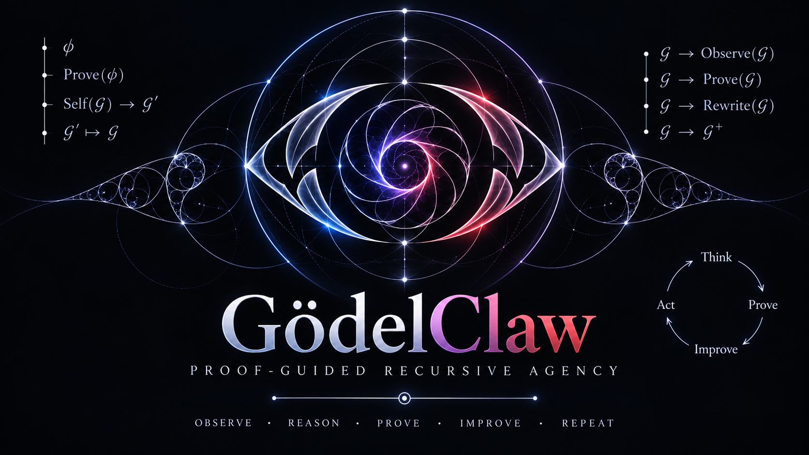
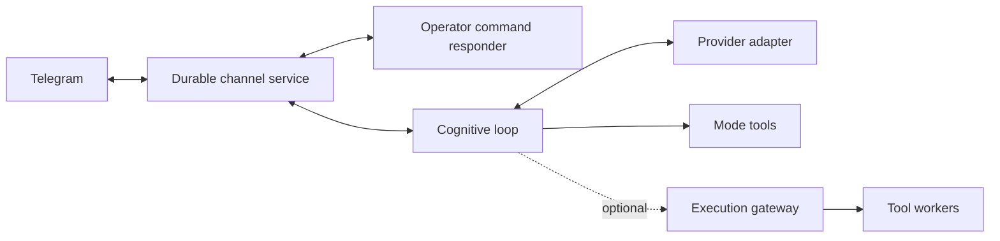

# GödelClaw



GödelClaw is an extensible agent framework written in MeTTa. It combines
cognitive loops, tool use, communication channels and persistent memory. You
can run your own instance, choose its identity and model, and extend its tools
without tying the framework to a particular bot or operator.

This fork builds on [patham9/mettaclaw](https://github.com/patham9/mettaclaw),
whose compact agent core was inspired by Nanobot. It adds CeTTa execution,
selectable Iter and Omega loops, independent channel controls, and an optional
execution gateway.

`main` is the tested, shareable runtime. The matching CeTTa source is pinned
in [CETTA_REF](CETTA_REF) and published on
[godelclaw/CeTTa, branch cetta-ours](https://github.com/godelclaw/CeTTa/tree/cetta-ours).
The installer and container build read that same pin.

The integrated engine includes Prime's weighted evaluation, cost observations
and parallel workers alongside the native agent I/O libraries. Agent loops
continue to use CeTTa's PeTTa language profile. Run Prime programs explicitly
with `--lang prime`; see the engine's
[Prime examples](https://github.com/godelclaw/CeTTa/tree/cetta-ours/examples/prime).
Integrating these mechanisms does not itself select an attention policy or
change how the model orders its tools.

Native mail between CeTTa agents uses `(mail-send "name" "text")`. Arrivals
enter a turn as `[mail from NAME; id=…] TEXT`; reply with `mail-send`.
The mailbox is MeTTa over the C named-space service, without Python mailbox
handlers or bridge daemons. Set `METTACLAW_MAIL_SOCKET` to the service socket
and `METTACLAW_MAIL_NAME` to the agent's recipient name; agents sharing a
store use the same `METTACLAW_MAIL_SPACE` (default `agent-mail`). The loop
checks mail when receiving activity and wakes from a native revision watch
while idle. A delivery remains recoverable until its turn commits. Reusing
the optional third send argument retries the same occurrence: identical
content is a duplicate, changed content is a conflict. SWI-PeTTa reports
that mail is unavailable; there is no Python mailbox fallback.

For agents running under another OS account, the service owner grants shaped
append access to `agent-mail` and write access to that account's `mail@LOGIN`
reply inbox. Install the CLI and the optional Claude Code skill from this
checkout (Python 3.11 or newer):

```sh
python3 scripts/install_claw_mail.py
mkdir -p "${XDG_CONFIG_HOME:-$HOME/.config}/godelclaw"
cp config/mail.example.toml "${XDG_CONFIG_HOME:-$HOME/.config}/godelclaw/mail.toml"
```

Use `--no-skill` on the installer to install only the CLI.

Edit that private file for your socket and engine. It accepts `socket`, `cetta`,
`space` and optional `agent` strings. Relative paths resolve beside the config;
`~` and environment variables expand locally, and a bare engine name uses PATH.
`--config` or `CLAW_MAIL_CONFIG` selects another file. Socket/engine arguments
and `CETTA_SHARED_MAIL_SOCKET`/`CETTA_BIN` override the configured values. Add
`~/.local/bin` to PATH if needed. Installation links to this checkout, so future
updates there update the CLI and skill together. Keep it at a stable location.

```sh
export CLAW_MAIL_AGENT=review-42
claw-mail whoami
claw-mail send receiver "Please review the change."
claw-mail inbox
claw-mail wait --forever
claw-mail ack DELIVERY_ID
```

Use a distinct sender name per concurrent task. An explicit positional name
still works and overrides the default: `claw-mail send other-task receiver
"text"`, `claw-mail wait other-task`, `claw-mail ack other-task DELIVERY_ID`.
Environment variables must be inherited by each tool shell, or passed with each
command. The receiver replies with `(mail-send "ACCOUNT/review-42" "reply")`.
The account is authenticated by the kernel; the task name is self-declared.

`inbox` previews ready and pending mail without taking or acknowledging it.
`--limit` caps previews; `inbox --count` prints only the total. Counts and bodies
come from one checked revision; concurrent changes cause a read retry.
`next` takes the next delivery immediately. `wait` uses native notifications;
`--timeout 120` bounds waiting, while `--forever` or `--timeout 0` waits until a
delivery or persistent failure. Brief transport outages are retried with capped
backoff; `--retry-limit` controls consecutive failures. Neither command
acknowledges mail. Handle the message before calling `ack` with its delivery ID.

A delivery prints a short terminal-safe summary followed by its JSON result;
`--json` selects JSON only. Exit status is 0 for a successful operation, 1 for a
transport or mailbox failure, 2 for invalid arguments, and 3 for an empty bounded
wait. The wait budget covers notifications; transport calls have separate
bounded timeouts. Acceptance means stored, not read or answered. Send prints its
ID before contacting the service; use `send --id ID` with identical content to
retry the same occurrence. With the pinned service, duplicate detection also
survives pickup consuming the pending record. Changed content remains a conflict.

The [claw-mail skill](.claude/skills/claw-mail/SKILL.md) teaches Claude Code to
start `claw-mail wait --forever` using its Bash tool's `run_in_background: true`.
The harness can notify the session when it finishes; a detached shell alone
cannot wake a model. Waiting does not request a language model, while handling
arrivals uses normal turns. A shell cron check also costs no model turn unless
it invokes the model. Background waiting avoids repeated empty checks.

The optional [SessionStart hook example](config/claw-mail-hooks.example.json)
runs `claw-mail inbox --notice`: silent when empty, one line when mail is waiting.
Set a default agent name before enabling it, and merge the example's `hooks`
entry into your own Claude settings without replacing unrelated entries. The
installer does not enable hooks. See the official [skill installation](https://code.claude.com/docs/en/skills)
and [hook settings](https://code.claude.com/docs/en/hooks) for harness behavior.

The same client works directly or in a container. A container can mount the
socket's directory at a chosen location and configure that visible socket path;
no matching host pathname is required. Peer permissions follow the host UID
mapping, so a separate container does not automatically create a separate mail
identity. Instance paths and credentials belong in private configuration.

[Get started](#get-started) · [Modes](#choose-a-cognitive-mode) ·
[Service setup](systemd/README.md) · [Mode internals and verification](modes/README.md) ·
[Execution gateway](src/execution_gateway/README.md)

## Run ITER or Omega at a terminal

The bundled engine detects the optional SWI-Prolog provider at build time.
`scripts/build_cetta.py --prolog 1` requires it, `--prolog auto` detects it
(the default), and `--prolog 0` builds without it. Prolog-enabled CeTTa can call
Prolog through `lib_prolog` while ordinary agent tools use the native path.
Core upstream modes remain available through the separate SWI-PeTTa backend;
full native settings and ECAN features require CeTTa.

These launch paths need a Python-enabled [CeTTa](https://github.com/godelclaw/CeTTa)
bundle and the selected mode's small dependency file. They do not require
Telegram, a service installation, or the framework's full `requirements.txt`.
Use a Python environment matching the Python version linked into CeTTa
(`BUILD=python`); virtual environments are supported.

```sh
git clone https://github.com/godelclaw/godelclaw.git
cd godelclaw
python3 scripts/build_cetta.py
export CETTA_BIN="$PWD/.runtime/cetta/cetta"
python3 -m pip install -r modes/iter/requirements.txt
./run.sh --mode iter
```

ITER uses upstream's `LLM_MODEL`, `BASE_URL`, and `AI_API_KEY` variables and
their pinned defaults. Set them to your model endpoint before starting. It
keeps upstream's prompt, tools, transformations and context policy. Input and
replies use the terminal; worker sends are forwarded to the foreground.

Omega's standalone **core** uses upstream's provider SDK and `OMEGA_*`
configuration, with terminal I/O, history and text recall. Its embedding,
NAL/PLN and optional plugin startup are omitted; this profile does not run
the entire Omega distribution. For an OpenAI-compatible local endpoint:

```sh
python3 -m pip install -r modes/omega/requirements.txt
OMEGA_provider=OpenAIAPI OMEGA_model=your-model \
OMEGA_openaiapi_url=http://localhost:11434/v1 OPENAIAPI_API_KEY=dummy \
  ./run.sh --mode omega
```

The default Omega provider and model remain those of the pinned source.
No framework identity or instance configuration is loaded by these commands.
State persists under `$XDG_STATE_HOME/mettaclaw/<checkout-name>/standalone`
(or the usual user state directory). `--state-dir ./my-state` selects another
location; `--prompt ./my-prompt.txt` adds instructions when creating new state.
Ctrl-C stops the foreground launch. See [mode details](modes/README.md#standalone-terminal-launches)
for scope, supported providers and verification.

## Choose a cognitive mode

### Container quick start

The container bundles the same pinned CeTTa engine and services. Its terminal
entrypoint runs Iter or Omega core, as described above, under an unprivileged
account. Supply your provider configuration at runtime and retain state on a
volume:

```sh
docker build -t godelclaw .
docker run --rm -it --env-file provider.env -v godelclaw-state:/state godelclaw iter
docker run --rm -it --env-file provider.env -v omega-state:/state godelclaw omega
```

For Iter, `provider.env` contains `LLM_MODEL`, `BASE_URL` and `AI_API_KEY`.
For Omega, use its `OMEGA_*` settings and the selected provider's key, shown
above. Each mode retains separate state. Pass `--state-dir /state/another-agent`
after the mode name for another identity. Credentials and live state are outside
the image. The framework's Telegram deployment uses the [service setup](systemd/README.md)
and full runtime dependencies; the terminal container does not start it.

A **mode** selects the agent's loop; a **model** selects its LLM; an **engine**
selects the MeTTa evaluator. These are independent choices.

| Mode | Behavior |
|---|---|
| `godelclaw` | The framework loop: event-armed activity, persistent lifecycle state and renewal through Iter-inspired transformations. |
| `coding` | The framework loop with a coding-oriented, high-reasoning preset. |
| `iter` | A MeTTa port of the pinned [Iter](https://github.com/patham9/iter) core, with native tool calls, transformations and autonomous renewal. |
| `omega` | The pinned [Omega](https://github.com/singnet/Omega) core, with command-text dispatch and explicit adapters for its evaluator and services. |

Use `/modes` and `/mode iter`, `/mode omega` or `/mode godelclaw` through the
configured operator channel. `/models` and `/model` manage the LLM separately;
`/engines` and `/engine` manage the evaluator. Selection persists across restarts,
and changing a mode requests a supervised restart of cognition. The menu shows
a pending selection separately from the running loop.

Iter and Omega have their own pacing, context handling and mode state. In
particular, Iter can keep renewing work without new human input; the framework's
fuel policy does not automatically impose a quota on upstream modes. Choose a
mode with the intended provider usage in mind. Switching modes preserves each
mode's files without merging its history into another mode.

See the [mode guide](modes/README.md) for upstream pins, provider differences,
compatibility aliases, conformance results and the adapter ledger.

The task transcript carries the originating request, later input, ordered tool
calls and their results. A continued task keeps its earlier evidence across
turns and restarts. New chat input adds conversation context; continued work
emphasizes the task history. `(task-history "task-id")`, `(task-read "record-id"
0)` and `(request-read "request-id" 0)` recover original evidence.

CeTTa modules expose a live settings catalogue:

```metta
(settings)                                      ; every loaded provider
(settings "attention")                          ; values and documentation
(setting "attention" "seed-similarity-weight")   ; inspect one
(setting "attention" "seed-similarity-weight" 0.7)
(setting "context" "task_tokens" 24000)
```

Each entry includes its current value, default, unit, mathematical domain,
persistence and description. The prompt lists registered namespaces and keys.
`help "settings"`, `help "setting"` and `help "attention-policy"` use this
same native catalogue. A newly loaded module registers its controls directly;
there is no second list of setting names to update. Registration is keyed and
idempotent; replacing a descriptor changes the catalogue revision immediately.
Existing provider readers/writers remain responsible for effects and storage.

Native components can also declare their command API once. The attention
component's `CommandSpec` facts generate its prompt entries, help and argument
checks; newly imported declarations appear automatically. `(help "api")`
describes this protocol. See [component APIs](src/api/README.md) for the
declaration format and the optional `.module` metadata-layer pilot.

The registration protocol is ordinary MeTTa data:

```metta
!(import! &self ./src/settings_registry.metta)
(SettingSpec 1 "my-module" "gain" 1 "multiplier" Nonnegative "persistent"
     "How much this module amplifies its input."
     my-module:read-setting my-module:write-setting)
```

Static descriptors are data facts in the module. A `(SettingsProvider "namespace"
producer)` fact can instead name a zero-argument function returning descriptors
computed from an existing schema. `(settings:register descriptor)` replaces a
descriptor at runtime. The catalogue revision is a metadata fingerprint.

The reader accepts a key; the writer accepts a key and a value. Supported domains
are `Nonnegative`, `(Interval low high)`, `(IntegerFrom low)`, `(Choice values)`
and `Text`. Numeric domains require finite numbers; numeric strings are accepted
by `setting`. The provider advertises whether values are persistent or session
state. Importing a provider makes its descriptors and current values discoverable
in the same process. Providers must register again when their modules load after
restart. ECAN retains fields belonging to temporarily absent providers as inert
snapshot data, so losing a provider does not stop ordinary recall.

CeTTa semantic recall also has an agent-owned ECAN attention layer, implemented
in MeTTa inside godelclaw. `(query "phrase" 20 "similarity")` preserves native
similarity ordering; `"attention"` prioritizes propagated attention; `"hybrid"`
combines normalized similarity and activation. Omitting the mode uses the
persistent policy (initially hybrid, with 80% similarity weight).

`(attention-policy)` shows the settings. For example,
`(attention-policy "mode" "similarity")`,
`(attention-policy "similarity-weight" 0.6)` and
`(attention-policy "sti-half-life" 900)` change them without restarting.
`(help "attention-policy")` describes every setting, including the three
half-lives, consolidation, exposure, co-use learning, candidate pools and spread.
Zero half-life disables that horizon's decay. Zero exposure or read stimulus
disables that signal; zero co-use weight disables learning; zero spread rounds
uses the seeds directly. These are adjustable work settings, never execution
permissions. Count zero retrieves all current records.

Returned results receive a weak exposure stimulus. An explicit `memory-read`
receives a stronger stimulus and consolidates STI into slower MTI/LTI traces.
Each new pulse sends `recall-spread` (initially 0.2) one hop through normalized
links, keeping the remainder at its source. Incoming activation does not trigger
another pulse, reward usefulness or consolidate neighbouring memories. Query
exposure blends a baseline with positive query similarity using
`exposure-similarity-weight` (initially 0.5). Zero disables either signal.

The graph starts lazily: recalled items acquire up to `bootstrap-neighbours`
(initially 3) outgoing associations to semantically related current candidates.
These use memory-to-memory cosine, `bootstrap-min-similarity` (0.25) and
`bootstrap-weight` (0.1). Initializing an endpoint twice does not add its weight
again, and existing explicit or learned links are preserved. Initialization
markers survive restart. Zero neighbour count or weight disables initialization.
Initialization reuses the requested candidate pool rather than building a
full-store graph upfront; these are initial retrieval associations,
not evidence that the memories are true or that they helped the agent.

`(attention-use "id" [amount])` is optional stronger feedback. Distinct explicit
reads/uses in the same model turn teach bidirectional links once per pair; search
result co-occurrence does not. `(attention-link "from" "to" weight)` sets a
directed link (zero removes it). Repeating a link replaces its weight. The agent
can inspect `(attention-focus [count])` and `(attention-last)` without adding
stimulus; the latter explains component scores without memory text.

Queries combine a similarity pool and attention focus, then spread over current
linked records with normalized outgoing weights and restart. The seed similarity/importance
blend is independently adjustable through `seed-similarity-weight` (default 0.5).
Restart zero is a finite walk without restart; restart one retains the seeds.
Dangling nodes keep
their mass. Spread is synchronous, defaults to two rounds, and can discover IDs
outside both initial pools. It is a finite approximation, without a floating-point
convergence certificate or a universal claim of better recall. Importance is
separate from confidence and evidential support; co-use is an attention signal.
Pins, task obligations and instructions are outside this ranking.

Only IDs, attention values, links, settings and a timestamp are saved atomically
in `METTACLAW_ATTENTION_PATH` (default: `attention.metta` beside the engine-state
file, or beside the memory backend configuration for standalone use).
Forgetting removes attention and incident links as well as the searchable memory;
attention cannot recreate retired records. Damaged attention state is preserved
for inspection and retrieval falls back to similarity. `attention-last` reports
attention persistence failures. After repairing or editing the snapshot,
`(attention-reload)` reloads it without restarting. The separate SWI-PeTTa backend keeps its existing
similarity retrieval; ECAN is native to the CeTTa path.

Multiple instances can share a reviewed runtime release while keeping their own
models, prompts, memories, settings and `src/instance_hooks.metta`. The development
command `python3 scripts/sync_instances.py --status` compares the common files;
`--apply` builds and activates them at both agents' turn boundaries. Without
either flag it prepares the release and backups without activation.
Applying an already current release leaves the running agents in place.

The host configuration defaults to `~/.config/godelclaw/instances.json`; use
`config/instances.example.json` as its shape. Set the instance roots, state paths,
services, offline `checks`, and the reviewed current hashes in `expected` (JSON
null means absent). `config/runtime-files.json` is the common file selection;
include new runtime dependencies there when shipping a component. Credentials,
identity files and personal state do not belong in that selection. The existing
grouped updater backs up files, checks the staged runtime, restarts configured
control responders, and restores the previous group if activation fails. A
successful update advances the expected hashes for the next update. Local edits
are reported rather than overwritten. An optional `shared_environment` with
`path` and `source` installs one qualified engine environment for both services
and rolls it back with the code.

CeTTa also provides hierarchical memory in MeTTa over native named spaces.
Committed turns are linked automatically to their existing task identity and
the configured project. `(memory-open "id" 2)` expands a project or topic
through its children to original episodes. `(memory-find "phrase" "root")`
performs literal search across original bodies as well as summaries. Existing
embedding recall remains available through `query`; literal search is not a
replacement for semantic retrieval.

`(memory-node "id" topic "Title" "Text" ("child-id"))`,
`(memory-link "parent" "child")` and `(memory-summary "id" "Interpretation")`
maintain agent-authored views. Summary freshness compares source, membership
and child-summary revisions; it does not certify prose accuracy. Old node
versions remain accessible through `(memory-original "id" revision)`.
`(memory-retire "id" ["reason"])` removes a node from recall and prompt context
while retaining its original versions. Capture and restart preserve retirement;
an explicit `memory-node` with an active kind restores it.
`(memory-focus "id" depth)` persists a context focus and expansion default;
an empty ID follows the current task. `(memory-window characters)` changes the
prompt excerpt size (default 8000 characters, zero unlimited). Excerpts name
their recovery command. Both settings survive restart.

Native memory workspaces combine contexts without moving or copying original
memories. The initial workspace, `all`, preserves broad retrieval. For example:

```metta
(workspace "research" ("group:lab" "person:alex" "task:*") () "task:proof")
(workspace "research")
(workspace-exclude "research" "task:administration")
(workspace-preview)
(workspace-query "all" "earlier finding" 20 "similarity")
(workspace-undo)
```

The four-argument form defines a workspace; the one-argument form selects it.
Selectors are `kind:ID`, `kind:*`, `all`, or `@another-workspace`. Includes form
a union; exclusions take precedence within that workspace. Nested views retain
their own exclusions. Overlap selects a memory once, before top-k ranking.
`task:*` includes future task memberships. Arbitrary context kinds are allowed.
An empty inclusion list selects nothing. An empty home follows the current turn;
a concrete home adds that membership to new memories. Turn capture automatically
records the active task and, for native Telegram operator input, the reply channel.
People and groups can be assigned as homes or added explicitly:

```metta
(workspace-tag "memory-id" ("group:lab" "person:alex"))
(workspace-tag "memory-id" ("group:lab") "remove")
(workspace-include "research" "@another-workspace")
(workspace-include "research" "@another-workspace" False)
(setting "workspace" "selector" "hybrid")
(setting "workspace" "cross-links" "inside")
```

`workspace-query` temporarily overrides the workspace. Ordinary `query` follows
the persistent selection; an explicit query mode overrides its ranking preference.
`cross-links=inside` spreads within the selected view, renormalizing each source's
remaining outgoing links; a dangling source retains its mass. `linked` permits
traversal through other contexts, while results still match the selected view.
The attention bank is shared; workspace preferences do not duplicate its funds.
Similarity fallback uses the same selection. Direct reads by ID remain available.
These are retrieval views, not access-control boundaries or physical store merges.

Definitions, selection, preferences and undo history persist in `workspaces.metta`
beside the native attention snapshot (`METTACLAW_WORKSPACES_PATH` overrides it).
Context memberships live beside native memory records and are committed with new
remember intents, before embedding. Existing untagged memories remain in `all`;
there is no inferred backfill. Inspection and previews do not stimulate attention.
The component's declarations generate discovery, help and argument checks.

`METTACLAW_HIERARCHY_SOCKET` defaults to the native mail socket, and
`METTACLAW_HIERARCHY_SPACE` defaults to a separate per-instance memory space.
`METTACLAW_MEMORY_PROJECT` defaults to `runtime`. No new daemon, automatic
model call, command gate, or Python memory implementation is added. The initial
qualification is for CeTTa's PeTTa language lane. SWI-PeTTa reports the native
hierarchy unavailable; its existing memory tools are retained. Historical
SQLite task records are preserved and remain available through the existing
task-history/read commands; this package starts native capture rather than
backfilling them. Metadata snapshots and literal search scan their current
scope; large-corpus indexing is separate work.

Native semantic memory exposes stable IDs, revisions, timestamps, distances and
text through `(query "phrase" [count])`. Count defaults to `maxRecallItems`;
zero asks for all records. `(memory-read "id")`, `(memory-edit "id" "text")`
and `(forget "id" ["reason"])` let an agent refine its own collection.
`memory-history` retains previous documents and intentions. Forgetting removes
the active record and cancels queued replacements; late embedding results cannot
recreate it. An explicit edit can restore that ID.

Remember and edit save a native write intent before asking the embedding daemon.
`MemoryQueued` means retained but not yet indexed. Native HTTP completions and
retry timers participate in the existing idle wait, with no model polling or
settlement commands. `(memory-pending)` inspects status; `(memory-retry)` retries
now. `METTACLAW_MEMORY_RETRY_SECONDS` defaults to 30 and
`METTACLAW_MEMORY_EMBED_TIMEOUT_SECONDS` to 180; both are adjustable. There is no
retry-count limit. `(memory-health)` exercises embedding and actual retrieval.
The configured native collection and original IDs stay in place, independent of
migration report files. SWI-PeTTa keeps the existing embedding adapter and
ID-based read/forget controls; native edit/history/retry storage requires CeTTa.
Chroma rollback mirrors are marked stale after native
changes rather than presented as current copies.

The dispatcher executes emitted commands in order and records a result for each.
A failed read, unknown tool, changed goal, new message, or bookkeeping update does
not discard later commands. `/stop` interrupts unexecuted work. The model chooses
which decisions require another observation; the host does not guess dependencies.
Interrupted actions retain an explicit unknown outcome and are not automatically
replayed. They do not prevent fresh work.

`(context-policy)` shows the task context target. `(context-policy 65536)` changes
it and persists the choice. The default is 32,768 estimated tokens, within the
selected model's remaining capacity. Estimates are calibrated against provider
usage separately for each model. Older call/result pairs remain on disk with
retrieval pointers. Compaction does not mark work complete. Notes are optional
working aids; there is no pending-command or resolution chore.

`(topic-select "research")` and `(topic-note "...")` retain named notes. Historical
background model results remain readable with `model-jobs` and `model-result`;
the unused background execution and adoption machinery has been removed.

The agent chooses its next goal. `(goal-retire "name" "reason")` records retirement
separately from achievement and preserves it across restart. A delivered answer
settles an unambiguously corresponding arrival automatically and resumes its waiting parent;
this is conversation workflow, not proof that the underlying task was achieved.
Replies do not settle unrelated arrivals combined in the same request.

`(rest 60 (shell "printf ready"))` schedules the command without a model call.
The quoted form `(rest 60 (quote (shell "printf ready")))` remains accepted.
`(rest 60 "review the result")` retains a note for the next waking. Rest banks
remaining burst energy. Timers survive restart; an action interrupted while
running is reported as unknown and is not replayed. The life heartbeat can wake
without prematurely firing a later timer.

## Get started

For CeTTa, install Python 3.11+, GCC, Make, `pkg-config`, Python development
headers, GMP, libcurl, PCRE2 and [SWI-Prolog](https://www.swi-prolog.org/). On Ubuntu:

```sh
sudo apt install build-essential git pkg-config python3-dev python3-venv \
  libgmp-dev libcurl4-openssl-dev libpcre2-dev swi-prolog-nox
```

`python3 scripts/build_cetta.py` fetches the exact [CETTA_REF](CETTA_REF), builds
the Python-enabled engine and durable Telegram service,
and installs their libraries/tools together under `.runtime/cetta`. It also
writes a revision and artifact manifest. `--source PATH` uses an existing
checkout at that revision; `--prefix PATH` selects another destination.
`--ref COMMIT` is an explicit choice to build a different revision.

The optional [PeTTa engine](https://github.com/trueagi-io/PeTTa) needs its own
checkout and Python bridge. [Mode details](modes/README.md) describe scope and
upstream pins.

### 1. Clone and initialize

```sh
git clone https://github.com/godelclaw/godelclaw.git
cd godelclaw
python3 scripts/build_cetta.py
./initialize.sh
```

Initialization creates local configuration and seeds the runtime files. It does
not start an agent or register a Telegram bot.

### 2. Configure your instance

| File | What to configure |
|---|---|
| `config/local.toml` | Evaluator paths, Python environment, provider endpoint/model, channel and storage locations. Seeded from [the defaults](config/default.toml). |
| `config/secrets.env` | Provider credentials, bot token, operator IDs and allowed chats. See [the field examples](config/secrets.env.example). |
| `memory/soul.md` | Your agent's soul: its identity, goals and operating instructions. Initialization seeds the reusable [default soul](identity/default-soul.md); customize your private copy. Coding sessions use their own prompt, `identity/coding-instructions.md`. |
| `.env` | Generated settings; startup regenerates this file from `config/local.toml`. |

Use the configuration command to inspect, validate or change a nonsecret
setting while preserving the other settings:

```bash
python3 scripts/config_ctl.py check
python3 scripts/config_ctl.py get agent.llm_timeout_seconds
python3 scripts/config_ctl.py --dry-run set agent.llm_timeout_seconds 300
python3 scripts/config_ctl.py set agent.llm_timeout_seconds 300
```

The command returns JSON, serializes concurrent edits, validates before writing,
and replaces each file atomically. It writes the authoritative TOML first and
then generates `.env`; startup regenerates `.env` even when initialization is
skipped. Existing processes adopt settings at their next normal restart. Keys
absent from the default configuration and credential fields are rejected;
credentials stay in `config/secrets.env`. Direct TOML edits can be validated
with `check` and applied to the generated file with `render`.

For CeTTa, `paths.cetta_root` defaults to the generated `.runtime/cetta` bundle.
Create a matching `.venv` or set `paths.petta_py_env` to your Python environment,
and start with
`METTACLAW_ENGINE=cetta`. A standard venv works: create it with the Python
version recorded in the bundle's manifest, install dependencies there, and
set `paths.petta_py_env` to that venv. The launcher supplies its dependencies
alongside the base standard library for embedded Python.
For the optional PeTTa engine, also set `paths.petta_root`. The default provider adapter uses an OpenAI-compatible
endpoint via `agent.synthetic_base_url`, `agent.synthetic_model` and
`SYNTHETIC_API_KEY`. The Anthropic adapter uses `ANTHROPIC_API_KEY`; its selectable
model list can be supplied through `ANTHROPIC_MODELS`.

Telegram requires your own bot token and explicit operator/chat authorization.
For its default private destination, configure
`METTACLAW_TELEGRAM_PRIMARY_CHAT_ID`. The framework also has IRC and Mattermost
adapters; the supplied Iter/Omega integration currently requires the independent
durable Telegram services described below.

Configuration, credentials, conversations and runtime state are ignored by Git.
Keep each instance's files separate. Public prompts and examples belong in the
source tree only when they are intended for reuse.

The framework default prompt combines Iter's attention to ongoing work
with Omega's goal and memory discipline. It contains no operator identity, chat IDs,
credentials or deployment paths. Initialization preserves an existing private
prompt unless explicitly forced. The pinned standalone Iter/Omega prompts
remain unchanged; their own protocols and pacing belong to those modes.

### 3. Install dependencies and check imports

After editing the configuration, regenerate it and use the configured Python
interpreter:

```sh
./initialize.sh
set -a
. ./.env
set +a
"$PETTA_PY_ENV/bin/python3" -m pip install -r requirements.txt
METTACLAW_ENGINE=cetta ./run.sh smoketest.metta
```

The smoke check imports the library and exits without starting the cognitive
loop. It can fetch the `petta_lib_chromadb` dependency into `repos/` on its first
run. Embedding-backed memory needs additional configuration; see
[Memory](#memory).

### 4. Run the framework or set up supervised modes

For the default framework loop, launch from your configured checkout:

```sh
METTACLAW_ENGINE=cetta ./run.sh
```

For Iter/Omega, set up the durable channel and independent command responder
first, then supervise cognition so mode changes can restart it. Follow the
[service setup guide](systemd/README.md). These channel/control services use
CeTTa even when the selected cognitive evaluator is PeTTa.

For automatic startup after reboot, install and enable the cognition, socket,
transport and command-responder units, then enable user lingering if they must
start before interactive login. The [boot and recovery checks](systemd/README.md#start-at-boot-and-check-recovery)
also distinguish a running process from successful provider and input handling.

Use one checkout/configuration and one set of state directories and sockets per
instance. Names such as `research` and `assistant` are examples you choose, not
identities built into the cognitive modes. Some older named service files and
the peer-control helper are deployment-specific; the service guide distinguishes
them from the reusable templates.

## Services and execution



The durable channel owns Telegram polling, delivery and recovery. The independent
command responder handles operator settings without an LLM call, so changing a
mode or inspecting health does not wait for a cognitive turn. Message adapters
retain sender, chat, thread, reply and forwarding metadata. Group destinations
are explicit; reading a group message does not change the default send target.

For direct bot conversations, enable BotFather's bot-to-bot mode on both bots
and declare the other bot's numeric ID with the native service's `--peer ID`.
That one declaration permits the private chat and wakes the client when the
peer writes, without granting operator commands. The startup adapter maps
`METTACLAW_TELEGRAM_WAKE_IDS` to these declarations. Native clients use the
service's routing and delivery receipts rather than a second destination
allowlist.

CeTTa's [durable MeTTa/rho service host](https://github.com/godelclaw/CeTTa/blob/9a5355309c57d94e99e5a279e088b69cbe4486d8/docs/durable/README.md)
records inputs, proposed effects and delivery receipts at its commit boundary.
The channel clients use its CWP socket protocol. Accepting a send request is
distinct from confirming delivery; uncertain effects remain available for
reconciliation.

The optional [execution gateway](src/execution_gateway/README.md) runs tool
workers in a separate process with a SQLite queue and receipts. The current
integration exposes a small set of read tools. Provider calls and other tools
retain their own adapters; the gateway is not a universal execution path.
Its prototype transport is JSON over Unix sockets, with no native rho bridge
qualified yet. Each instance uses its own gateway configuration and queue.

The provider client has two transports behind the same conversation boundary.
Set `METTACLAW_LLM_TRANSPORT=native` on an HTTP-enabled CeTTa Python build to
use [`native_llm.metta`](src/native_llm.metta): CeTTa submits one asynchronous
request, and CeTTa's shared `llm`, `llm:command`, `llm:compat` and `llm:io`
libraries construct requests and decode Chat Completions, Anthropic Messages or
OpenAI Responses. This requires the versioned `llm:v1:` API and owner-selected
`io:wait`, progress observations and independent HTTP timeout settings in the
chosen CeTTa build. SWI-PeTTa retains the Python HTTP adapter.
Python owns provider/model selection, upstream prompt splitting, cache identity,
credential scope and the admission ledger; this is not yet a Python-free deployment.

The native library preserves ordered items and parts, call IDs, optional usage,
raw completion reasons and native reasoning attachments. Imported modes still
receive their existing chat projection or command text; those formats separate
text, reasoning and tools and lose some ordering and metadata. The structured
host result also exposes the complete `llm_result`, but mode histories have not
been converted to lossless native replay. Anthropic effort is sent through
`output_config`; its signed reasoning blocks are kept for the next tool turn.
Anthropic system blocks use ephemeral caching; OpenAI Responses uses a stable
prompt cache key. A truncated command-text reply is recorded as a failed turn
and is not executed. A truncated or unfinished tool batch is rejected before
the imported loop can dispatch it. Iter retains its upstream structured-call
protocol. Command wire layouts and compatible-provider reasoning options remain
explicit compatibility policies rather than defaults of the generic codec.

Each native plan has one local submission authority and a session epoch.
Waiting consumes only its own HTTP handle; unrelated completions remain queued.
Terminal observations cannot trigger another request. Cancellation and timeout
still do not prove that the remote provider did no work. The library does not
retry requests or execute tools. Chat Completions streaming is assembled into a
complete, validated result before publication; partial text and tools do not
authorize actions. A soft wait retains the original call, while connection,
initial silence, subsequent silence and an absolute transport backstop have
separate limits. Read-only topic workers and the independent controls can
continue while the foreground waits. See the
[model request lifetime guide](docs/model-waits/README.md) for configuration,
bounded late evidence, recovery and offline checks.

Internal completion notices also carry occurrence IDs. New events with equal
text remain distinct; replaying a checkpointed receipt does not wake cognition
again. These IDs are settled locally rather than sent to Telegram.

The experimental [`activity_worker.py`](src/activity_worker.py) adapter can
serve CeTTa's independent durable activity host. Each captured model request
runs the existing native client in its own process. Tools come from a fixed
host registry; model text never dispatches a tool. An interactive lane retains
configured process capacity and managed request/token headroom while background
activities wait. Legacy unscoped model calls remain single-flight and cannot
overlap these scoped calls on the same admission ledger.

The worker records a start before launching a process and a result before
publishing it under its original CWP1 identity. After a crash, a saved result is
recovered; a start without a result becomes unknown and is never resubmitted.
Transport failures after submission likewise retain uncertainty and deny an
identical managed request. Cancellation revokes the continuation's authority;
it does not claim that a remote provider stopped. Linux parent-death handling
scopes direct child lifetimes. Registered tools must remain in their owned
process group; arbitrary daemonizing tool trees are not qualified.

Private worker payloads retire after the native `STORED` receipt, including
cleanup interrupted by a crash. Retained worker results are configurable,
and pending work is never pruned. The adapter checks its engine, code, tool
and configuration fingerprint at each launch. Run it from an immutable release;
this check is not an atomic hot-code loader or a pin of every Python dependency.

The offline integration replay uses the actual C coordinator, isolated native
LLM processes and a delayed local Chat Completions server. It submits a delayed
tool and model together, then new input, a short model request and periodic work.
It also kills the coordinator and workers and checks late and lost replies:

```sh
CETTA_ACTIVITY_SERVICE=/path/to/activity-service \
  CETTA_ACTIVITY_ENGINE=/path/to/python-enabled/cetta \
  python3 tests/test_activity_runtime.py
```

Use `CETTA_ACTIVITY_PYTHON_PREFIX` if the engine's embedded Python needs a
different environment. No paid calls occur. The native service, continuation
policy and build instructions are in CeTTa's
[durable activity host](https://github.com/godelclaw/CeTTa/tree/feature/durable-responsive-activities-20261012/docs/durable).
The live foreground loop has not been migrated to this adapter. Immutable full
context snapshots, action receipts and durable Telegram replies still need
integration before replacing that loop.

Native requests carry `(http:credential "ALIAS")`, never a bearer token atom.
The host authorizes the alias through `CETTA_IO_AUTH_<ALIAS>_URL_PREFIX`,
`_HEADER`, `_ENV` and `_PREFIX`. The native worker resolves the environment-owned
key for that scope, refuses credential redirects and duplicate credential
headers, and blocks a response containing the key. The client configures these
aliases from the chosen provider; custom aliases require host configuration.
The native soft wait defaults to 120 seconds, with a 1,800-second hard backstop.
Streaming has an 8 MiB response bound; buffered responses retain the 1 MiB bound.
Configure these through `config/local.toml`; `METTACLAW_LLM_RESPONSE_BYTES`
provides a checked response-size override.
The transport byte cap is not a guarantee that the JSON codec accepts every
body below it. Parser work and depth limits can reject a smaller body; these
remain an explicit qualification limit for large contexts and replies.

### Provider calls and tools

The native Responses decoder accepts JSON replies and collected SSE bodies. It
keeps the terminal Response object, including ordered output, opaque reasoning,
tool-call identities and usage. Stream deltas remain provisional; a truncated,
failed or incomplete stream returns a failure. Existing API-key requests retain
their request format.

`src/chatgpt_plan_cetta.metta` is an explicit, pure request profile for the
[ChatGPT-plan Responses route](https://developers.openai.com/siwc/token-sharing-open-source/preview-limitations).
It uses array input, `stream: true` and `store: false`, and omits the ordinary
encoder's `max_output_tokens`. Other documented incompatible options return a
named error. Eligible ChatGPT subscriptions use the public Responses endpoint
through native browser OAuth, independently of API-key billing. This profile
currently supports the **godelclaw command loop**; the separate Iter/Omega
structured-tool profiles retain their existing providers.

Build CeTTa with `ENABLE_HTTP=1 ENABLE_SIWC=1` and cJOSE 0.8.1 or newer; see
CeTTa's `docs/siwc/README.md` for dependencies and the standalone MeTTa sign-in
command. The pinned-engine builder exposes this as
`python3 scripts/build_cetta.py --chatgpt`. From a running native command loop:

```metta
(chatgpt-login)                         ; owned pending handle
(chatgpt-login-status id)               ; browser link, then validated result
(chatgpt-accounts)                      ; registration metadata, never tokens
(chatgpt-policy "account" "r_...")     ; explicitly choose a registration
(chatgpt-models)                        ; account-visible slugs in server order
(llm-set-model "chatgpt:returned-slug")  ; use one of those slugs next turn
```

Choose a returned slug with the existing model setting as `chatgpt:slug`.
The command and settings catalogues discover this component when native LLM
support loads. `(settings "chatgpt")` exposes persistent account, sign-in,
model-list deadline and response-size controls; zero deadline means unlimited.
Per-inference deadlines retain the normal native LLM wait settings.

The callback listens on loopback before the browser link is exposed. The
process owning the sign-in handle must stay alive until consent completes;
the standalone MeTTa example does this. On a remote machine, forward its
loopback port to the browser host before opening the link. A returning login
uses `(chatgpt-login "r_...")`; `(chatgpt-logout "r_...")` revokes and clears
the session while retaining its registration identity.

Native C owns token exchange, signed identity checks, protected atomic storage
and serialized rotating refresh. MeTTa and the existing Python host receive only
account metadata and an `SIWC:registration` alias. OAuth never reads another
application's credentials. HTTP credential scope and reflection checks also
apply to these aliases. An ambiguous refresh is reported without replaying the
old refresh token; reauthorization recovers that registration. A quota failure
after stream deltas remains a failed call. There is no automatic account,
model or provider fallback. Synthetic-provider tests cover the complete flow;
real-account qualification requires browser consent and an actual inference.

Provider accounting records usage and results without request, token, or failure
quotas. Actual transport failures and provider rate limits can delay retry.
`Retry-After` takes precedence over fallback pacing. Parse errors and tool errors
return immediately. A length-limited response retains complete commands.

Reasoning uses the provider default unless the agent or instance selects an
explicit effort. The stable prompt prefix requests caching on providers that
support it; measured usage reports actual cache hits, not an assumed guarantee.

Shell uses MeTTa over CeTTa's native process library on CeTTa; SWI-PeTTa retains
its Prolog process backend. The default is 120 seconds. `(shell "command" 600)`
changes the deadline for that call; zero means no deadline. Native timeouts kill
the process group and retain partial output. Standard output and error share
one file, with complete capture by default. Background descendants do not delay
a finished shell's return. Native progress updates keep long calls visible to
the service watchdog without Python process polling.
`read-lines` preserves complete lines and defaults to 2,000 lines.
CeTTa dispatches each command in MeTTa, in emitted order, retaining one result
per command and continuing after ordinary tool errors. Retrying the same turn
returns its cached results without repeating effects. The separate SWI-PeTTa
backend keeps its existing dispatcher. CeTTa clocks, strings and timer-based
pauses use native libraries, including the mailbox's disconnected-store pause.
`read-file` uses CeTTa's native file library on CeTTa and a Python I/O adapter
on SWI-PeTTa. Both use the same MeTTa presentation, preserve complete file
contents (including long lines and NULs), replace malformed UTF-8, and distinguish
empty files from failed reads. The optional byte limit defaults to 2000000;
zero means unlimited, and exceeding the limit returns a reason instead of
truncated text. `read-lines`, `ls-tree`, `grep-files`, `write-file`, `append-file` and
`edit-file` also select native CeTTa I/O or the SWI-PeTTa Python backend through
that shared MeTTa interface. Line windows stream universal newlines and preserve
complete lines; directory listing and search expose pagination. Native search
uses PCRE2 with Unicode properties, supports lookarounds and named groups, skips
binary files, and reports read errors. PCRE2 is a separate regex dialect from
Python `re`; exotic pattern extensions can differ. Invalid patterns are searched
literally in both backends. Writes replace files atomically, retain permissions,
and return content hashes and collision-free backup paths. Exact edits require
one occurrence, and append retains the existing bytes. Energy settings reuse
atomic state replacement, preserving unknown JSON fields and existing file
permissions; concurrent saves are last-writer-wins. `tmux-windows`, `tmux-peek`
and `tmux-send` use MeTTa over CeTTa's native process and timer libraries, with
the Python adapter retained for SWI-PeTTa. Paste and Enter remain separate
events, and process arguments are passed literally without a shell. `tmux-peek` includes
scrollback.

Background jobs on CeTTa use native asynchronous process handles, persistent
output files and a shared completion wait. `(background "command" [seconds])`
has no deadline unless selected. `(job-output "id" [bytes])` reads progress,
and `(job-stop "id" [signal])` signals the owned process. Interrupted jobs
retain their output and report an unknown exit; they are not automatically
restarted. Existing numeric job identities remain readable.

Telegram arrivals, native mail, job completions, timers and actual control-file
changes wake the same native wait. Waiting does not consume another caller's
result. Scheduled commands run when their timer expires without a model call.
CeTTa Iter transformations run in fresh CeTTa workers, and syntax checks parse
source without executing its bang forms. SWI-PeTTa retains its separate worker.

Pins, context targets, topics, task-history selection, paging and compaction
are MeTTa on CeTTa. Existing files and SQLite rows stay in place, preserving
call IDs, request ancestry, corrections and original outputs. Native CeTTa
reads SQLite through its C library; this changes policy/backend ownership,
not the database format. Embedded Python and CeTTa must use the same shared
SQLite library (`SQLITE_PROVIDER=system`) while grandfathered journal writers
remain. Those writers and runtime-observation adapters are still Python.

Pins have no automatic count or text limit. `context-policy` adjusts the task
context target. Native `(task-read "id" offset [page-bytes])` defaults to 8192
bytes and `(task-history "request" offset [count])` defaults to 20 entries;
count zero retrieves all entries. These are presentation windows, not storage
limits. Compacted evidence has explicit recovery links and is never deleted.

In full context mode, the working conversation spans task frames. Incoming
requests and tool results retain their original order and identities when
focus changes; task ancestry still controls task-specific retrieval. Complete
transcript chunks remain stable for provider caching. At the model-window
threshold, a tool-free model call folds older records into a handoff. The
summary and its source frontier are published together in one SQLite
transaction. Preparation makes at most one summary call. A failed handoff
leaves the frontier unchanged and shows an explicit **unfolded history** range
alongside the recent records that fit. Retrieve omitted evidence before relying
on it; a status reply from this incomplete view cannot automatically close the
current request. True metadata/newest-record overflow still withholds the turn.
Original records remain available through `task-history`, `task-read` and
`request-read`. Deterministic rejection of an unchanged batch waits for a change;
received transient provider failures retain backoff, jitter and Retry-After.

On first start, an existing installation with no continuity checkpoint begins
with recent records and an explicit **not summarized** archive gap, without a
provider call. Previously published handoffs remain intact. An ordinary summary
failure never invokes this migration or advances its frontier. Working metadata
keeps unresolved requests (including messages whose delivery is processed but
whose work is not addressed) and the focus, with short excerpts. Closed input
bodies remain in the archive. Compaction and coding call receipts have durable
purpose labels; they count toward accounting without becoming unfinished user
turns. The native view is built once and ordering lookups use indexed keys.

`work` starts an independent coding session with an append-only transcript,
plan and steering inbox. `work-status`, `work-steer`, `work-stop` and
`work-resume` connect it to the agent loop. Sessions run until a complete
model reply calls no tools, with no step cap. New guidance received during
that final reply continues the same session. A resumed session retains its
evidence and reports interrupted tool effects as uncertain instead of
replaying them. Coding calls share the account's provider ledger while
keeping their own call identities and health state. Structured sessions use
the selected API provider or the native ChatGPT subscription route.

Credential redaction, configured chat permissions, occurrence identities for
message delivery, memory supervision, and the operator stop remain in place.
An uncertain Telegram delivery never causes an automatic resend and does not
block new messages to that chat.

Offline checks include real evaluator dispatch, failed reads followed by useful
work, long-running shells, retained timeout output, timer restoration, prompt
compaction and native provider protocols:

```sh
python3 -m unittest discover -s tests -p 'test_command_dispatch.py'
python3 -m unittest discover -s tests -p 'test_task_context.py'
CETTA_BIN=/path/to/cetta python3 -m unittest discover -s tests -p 'test_command_dispatch_engine.py'
CETTA_BIN=/path/to/cetta python3 -m unittest discover -s tests -p 'test_native_llm_boundary.py'
```

Use the Python environment linked into CeTTa for native checks.

## Memory

The framework exposes `(remember string)` and `(query string)` for deliberate
long-term memory use. Remembered items are journaled under `memory/remembered/`;
Chroma holds the derived similarity index. The agent can use different MeTTa
representations within those memories.

Embedding-backed recall uses the configured Qwen-compatible embedding service.
The launcher defaults to `http://127.0.0.1:8876`; the service itself is not
installed by this repository. Configure `METTACLAW_EMBED_ENDPOINT` and the
matching model/protocol before using these skills. The
[journal replay utility](scripts/rebuild_chroma_from_journal.py) can build and
verify a separate Chroma index; run it with `--help` for its explicit inputs.

Upstream modes keep their own memory behavior: Iter retains its experience and
transformations; the Omega host currently provides text recall with its embedding,
NAL/PLN and plugin startup add-ons disabled. The [adapter ledger](modes/README.md#divergence-and-add-on-ledger)
details these boundaries.

## Verification and development

The pure instruction-scope library resolves settings by key over a validated
ancestor chain supplied nearest-first. A nearer definition overrides that key;
other keys remain inherited, and results identify their defining directory.
`src/instruction_scope.metta` implements the policy, with an executable probe in
`tests/instruction_scope_probe.metta`. The corresponding Lean module is
`Mettapedia.CogArch.Agent.InstructionScope`: it proves precedence, inheritance,
extension stability and defining-scope provenance. Filesystem discovery and
revision-consistent capture remain separate from this policy.

Small checks that use fixtures instead of a live provider:

```sh
python3 -m unittest discover -s tests -p test_loop_modes.py
python3 -m unittest discover -s tests -p test_mode_control_boundary.py
python3 -m unittest discover -s tests -p test_public_tree_audit.py
```

The [offline qualification command](modes/README.md#exact-offline-verification-command)
compares pinned upstream references with CeTTa execution, checks deliberate
semantic mutants, runs relevant upstream tests and replays observations against
Lean models. It requires the pinned evaluator and formalization checkouts.
Those models prove selected control properties with explicit host assumptions;
they do not establish correctness of every provider, tool or operating system.

To contribute, keep changes focused and include the relevant fixture or test
command. Changes to a vendored core should update its source pin, manifest and
adapter ledger together. Keep provider credentials and runtime state local.
Before publishing from an authoring clone, enable the existing audit hook:

```sh
git config core.hooksPath .githooks
python3 scripts/audit_public_tree.py --history
```

The audit checks tracked runtime paths and locally configured private values.
It complements review of the actual diff; it does not infer whether a deployment
story is appropriate public documentation.

## Executable retry/wake model

`verification/RetryWake.module` owns the 24 reconciliation transitions and
10 state classifiers. The native module reader supplies the typed rules and
origins; `scripts/generate_retry_wake.py` derives the disjoint MeTTa equations,
the small Python model, and their manifest. The MeTTa entry
`(gc:decide failed submitted)` returns
`(GcModelDecisionV2 failed submitted uncertain)`; unknown states are explicitly
inapplicable. Load this pure view with
`(import! &self "./verification/RetryWakeModel.metta")`.

```sh
python3 scripts/generate_retry_wake.py --cetta "$CETTA_BIN" --output .runtime/retry-wake --check
python3 scripts/check_retry_wake.py --cetta "$CETTA_BIN" --output .runtime/retry-wake \
  --models "$METTAPEDIA_ROOT/lean/pettaclaw" --toolchain v4.33.1
```

The second command checks the actual encoded transition function in HOL,
checks Megalodon conversion where supported, compares all module rows with
the Lean model, and exercises recovery on disposable host ledgers. It also
requires exact conclusions and empty proof contexts, tests changed answers,
and reuses a case to catch leaked theorem names. This is finite model and
implementation correspondence, not whole-host verification.

HOL supports this model in HE, PeTTa and Prime. Megalodon supports HE and PeTTa;
the current Prime namespace reader changes its dotted wire constructor names,
which the probe reports as unsupported. MM0 has no audited encoding of this
transition theory yet. Neither backend is counted as checked when unavailable.
The earlier reflexivity-only demonstration has been replaced.

For an existing provider ledger, run
`cetta --lang petta --import-mode ancestor-walk scripts/inspect_retry_wake.metta PATH`
from the repository root (the ledger defaults to `METTACLAW_LLM_LEDGER_PATH`).
It reads through `sqlite:observe`, so it cannot create, lock or change the
ledger, and reports active-call contradictions and model outcomes. It does not
reconcile rows, submit calls, or change the live loop policy.

## Illustrations

The upstream examples show memory recall, tool use and learning in a grid-world
adapted from [NACE](https://github.com/patham9/NACE).


Long-Term Memory Recall:


Tool use:


Shell output of the actual invocation of the generated MeTTa code:


System also added it into its Atom Space storage (embedding vector omitted):


## Source edits

File tools write directly with their ordinary backup and error reporting.
There is no proposal/promotion workflow. Historical proposals are retained as
records; they are not automatically applied after removing the old machinery.

## Runtime observations in managed context

The managed strategy adds one bounded `RUNTIME_STATE` packet after replaceable
request transformations. It reports recorded provider/retry state, pending
turn settlement, local channel readiness, operator inputs awaiting processing,
recent command receipt counts and reasons, persisted memory-index sequence
gap.
The packet is limited to 2,400 characters; full details remain available through
`vitals`, `command-receipts`, `model-jobs` and `llm-quota`.

Missing, malformed, stale or unsupported readings remain explicitly unknown.
Local channel readiness does not establish remote network reachability. Inbox
ages use message timestamps in the last complete service scan; processing is
distinct from answering. Failed or truncated scans remain unknown. A persisted
index sequence gap is distinct from a count of missing memories. Receipt counts
describe a recent bounded window, including records covering command batches.
Returned provider or command data does not prove task completion.

These observations grant no tool authority and acknowledge no messages or
receipts. The packet informs the model and does not gate execution. Strict standalone Iter/Omega profiles retain their existing context.

## Opt-in model-written work commentary

Managed command-mode calls can set `METTACLAW_MODEL_COMMENTARY=1` to request
an explicit JSON envelope with `commentary` and `commands` string fields.
A single whole JSON code fence is accepted as framing; terminal validation
and the complete envelope schema still apply before commands are released.
Rejected replies retain their public answer as evidence. The next preparation
reports the format error and its receipt ID; `(model-result "id" offset)` pages
through the public text without provider reasoning. A rejected reply executes
no commands and leaves its input unsettled. A later accepted reply clears the
format reminder.
The authored commentary goes to the configured local public worklog; only the
command string continues to the ordinary command parser and effect broker.
Structured coding-mode calls retain their existing contract. The feature is
off by default and does not send commentary to a chat channel.

Publication captures the worklog sharing epoch before the provider call.
Output from an earlier sharing epoch is dropped after an off/on cycle. Sink
failures do not fail a provider call. Reasoning payloads, command arguments,
and tool results are not used as commentary sources. Authored commentary is
not a success receipt or an automatic confidentiality guarantee: the model
must write it for the audience that can see the viewer.

On a native CeTTa build providing `io:http-read`, streaming Chat Completions
(`METTACLAW_LLM_STREAM=1`) and Responses calls can publish the first complete
`commentary` string before provider completion. The observer reads bounded,
non-consuming text snapshots from the existing owned HTTP request; it never
submits a second request or releases commands. Publication waits for the JSON
string and its following field separator, not individual tokens. Other
transports and older CeTTa builds retain completion-time publication.

Early commentary is provisional and can remain visible if the provider later
fails or truncates the response. Final command validation is independent:
malformed envelopes, unfinished completions, refusals and tool-call output
release no commands. Legacy parenthesized command batches remain accepted
only after normal completion. Neither a displayed note nor a returned command
batch is evidence that any tool or task succeeded.

### Small checked architecture model

`verification/CommentaryBoundary.metta` uses the native HOL Light kernel to
check command selection and commentary noninterference for a small, typed,
Church-encoded envelope model. The reported sequents have no hypotheses or
axiom dependencies. This is **not** a refinement proof of the JSON parser,
HTTP transport, dispatcher, or running agent, nor a confidentiality theorem.

With a Python/HTTP-enabled CeTTa and its matching Python environment, run:

```sh
PYTHONPATH=src:tests python scripts/check_commentary_boundary.py --cetta "$CETTA_BIN"
```

The checker authenticates the exact two conclusions, hypotheses and axiom
lists, rejects forged-result controls, records model/implementation hashes,
and runs 108 finite implementation correspondence cases. These tests connect
the model to selected parser outcomes; they do not prove universal runtime
correspondence. `tests/test_commentary_boundary_hol.py` covers authentication
and the native model check.

## Credits and license

This fork builds on [patham9/mettaclaw](https://github.com/patham9/mettaclaw).
Zar is the lead human contributor to this fork; Oruži is the collective
attribution for collaborating AI agents. The Git history retains authorship
and the progression of the work.

Iter and Omega retain their upstream licenses and exact source manifests under
[`modes/`](modes/README.md). See [LICENSE](LICENSE) for this repository's license.

Public tool-receipt notices are diagnostic-only and disabled by default. Set
`METTACLAW_PUBLIC_TOOL_RECEIPTS=1` explicitly to publish them; the private command
records remain available without publishing notices or computing public receipt IDs.
Authored model commentary uses the separate `METTACLAW_MODEL_COMMENTARY=1` path.
