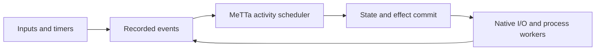

# Responsive activities over native I/O

A slow provider request should not occupy the cognitive scheduler until its
answer arrives. This experiment uses CeTTa's native HTTP worker and an authored
MeTTa scheduler to compare two callers of the same nonblocking transport:

* `blocking` recursively awaits the slow request before handling other work;
* `cooperative` retains each request identity and returns its continuation
  after every short slot, rotating between provider, input and timer work.

The peer is a local HTTP fixture. Its short response is not an LLM answer.
There are no model credentials, Telegram sends or changes to live services.

## Run

An HTTP-enabled CeTTa build with its Python bridge is required. Its library
directory must be available as in a normal installed bundle.

```sh
python3 examples/responsiveness_replay/run_replay.py \
  --binary /path/to/cetta --output /path/to/replay-results
```

If the binary embeds Python from a separate environment, also pass
`--python-prefix /path/to/python/environment`.

Defaults: a 16-second request, input arriving at one second, a 100-ms short
request, and absolute alphabet timer releases every five seconds. The runner
records request starts, completions, owned consumption, local input handling
and timer lateness. Both modes must send each request once and consume its
own completion once. The cooperative short response must precede the slow
response; the blocking input must wait until the slow response is observed.

For a shorter experiment, pass `--slow-ms 1600 --period-ms 500 --input-ms 100
--fast-ms 30`. The configurable fixture durations are test scenarios, not
production deadlines. Timing varies with the host and does not establish a
worst-case execution time.

`scheduler.metta` owns task selection and continuation state. `probe_host.py`
supplies only a clock, trace and loopback peer. Its short sampling pause avoids
busy spinning in the experiment. A production driver should arm an event wake
and the next absolute timer instead. The prototype has no durable task journal
or crash recovery and does not integrate the application's model-call ledger.

## Architecture implied by the experiment



The event recorder remains available during provider and tool work. One owner
serializes the agent's state and effect decisions. Independent operations may
overlap outside that owner and return recorded results; they do not mutate
the shared evaluator from worker threads.

An activity needs a durable identity and generation, an input batch, captured
dependencies, its continuation, a pending operation identity and owned result
receipts. Events and wakes are different: readiness is recorded, and sleeping
must recheck it after arming a wake to prevent a lost arrival. A completion
must be recorded before releasing its owned buffers. It can be retained as
evidence even when its captured authority no longer permits effects.

Overall pump progress and per-operation progress need separate health records.
Busy timers must not make a stalled provider look healthy indefinitely. An
operation keeps its own start, byte-progress and terminal evidence alongside
the scheduler's service stamp.

The MeTTa driver should return `done`, `yield` or `await` with a continuation;
`await` must return to the scheduler. Polling the same call in a recursive
function still monopolizes cognition, even though the transport runs on
another thread. Long filesystem, Python and shell operations need resumable
jobs or process workers. Limiting the number of commands or evaluator
reductions does not bound a slot containing a blocking host call.

Cancellation has separate meanings: stop awaiting, revoke effect authority,
ask the transport to stop, or confirm that nothing ran remotely. These must
remain distinct. A killed process with an uncertain remote outcome must not
blindly repeat the provider request or effect. Local atomic receipts do not
prove exactly-once execution by an external service.

## Current integration seams

* `src/native_llm.metta` already offers retained `llm:begin` and
  `llm:poll-once`, but its normal `llm:after-submit` recursively awaits the
  call. The cognitive driver must persist the plan and resume it later.
* `src/native_lifetime.py` admits only one claimed/submitted call globally.
  A yielding scheduler alone cannot start a second conversation call while
  that call is pending. Independent activities need scoped ownership and
  shared resource budgets, with interactive capacity reserved automatically.
* `src/loop.metta` and `src/turn_additions.metta` execute a whole model/tool
  episode before returning to input selection. A continuation must represent
  the intermediate phases, not pretend a suspended episode completed.
* `src/strategy_host.py` keeps one current turn, sample, ticket and command
  position in globals. `src/cognitive_health.py` and the command batch cache
  also assume one active episode. These require per-activity state before
  admitting overlapping model episodes.
* Existing independent control responders already handle deterministic input
  notices. Their default delay and rate policy are separate from the above
  scheduling limits. A canned receipt does not mean a model has read an input.
* The durable native host can commit input settlement, continuation, writes,
  effect intentions and a receipt together. It documents no concurrent use
  of the shared program/context. Reuse this boundary; do not introduce shared
  Atom/evaluator threads as an accidental concurrency model.

## Timing and resource contracts

The existing `EventPump.bounded_service_latency` theorem already includes a
wall-clock bound: `p + N*q` for local service, when the whole slot takes at
most `q`, readiness/intake takes at most `p`, and the queued prefix has at
most `N` activities. These are host obligations. Storage locks, native
callbacks, copied context and evaluator work count toward `q`.

The application currently permits a five-second SQLite lock wait in a host
call. It therefore cannot claim a millisecond scheduling slot merely because
the MeTTa rule or poll count is small. Fuel is not wall-clock preemption.

`ResponseTiming.lean` in MeTTapedia extends that existing model with six
results separating local service, provider readiness and delivery. Periodic
work completes before its next release when dispatch delay plus handler cost
fits inside the period. Release times are absolute, not a period slept after
each handler; the latter accumulates handler drift. A bound on local outbox
work does not bound reception by Telegram without an external delivery bound.

Memory is part of the same architecture. Suspended continuations are GC roots;
request and completed-but-unconsumed response buffers remain owned. Record
retained bytes per activity, share immutable context where safe, and release
roots only after settlement and required observation. Resource admission must
charge parked results too. Reserving an interactive slot needs matching token,
byte and cost capacity, not merely a second transport handle.

Recycling must save activity continuations without claiming that a pending
remote operation completed. If transport remains inside the recycled process,
an interrupted submitted request becomes uncertain. An independently owned,
durable transport service could retain and record it across a cognitive
restart; the current HTTP handles alone do not provide this property. Recall
can build a small activity-specific context from provenance-bearing memory,
while its original evidence remains available outside the active prompt.

Policies for scheduling, dependency checks, timer releases, coalescing missed
ticks, retry eligibility and recall belong in authored MeTTa. Native C should
provide transport, bounded primitives, event wakes and durable atomic commits.
Admission here is an automatic resource check; no manual approval schema is
required to make ordinary input runnable.

## Codex and OpenCode comparisons

Upstream Codex separates input acceptance from the running task. At commit
`9f3d25588b3f0bdf452d4eda919f2c2365a89bba`, its input queue subscribes to activity
before checking pending input, validates the active turn identity for steering,
and wakes sleep/wait tools on activity. Its `instant_interrupt` feature defaults
to enabled and can preempt sampling so a follow-up incorporates new input.
This is a scoped handoff, not a guarantee that a provider answers instantly.

Primary implementation references:
[input queue](https://github.com/openai/codex/blob/9f3d25588b3f0bdf452d4eda919f2c2365a89bba/codex-rs/core/src/session/input_queue.rs),
[sampling loop](https://github.com/openai/codex/blob/9f3d25588b3f0bdf452d4eda919f2c2365a89bba/codex-rs/core/src/session/turn.rs),
[feature defaults](https://github.com/openai/codex/blob/9f3d25588b3f0bdf452d4eda919f2c2365a89bba/codex-rs/features/src/lib.rs).

The public [App Server protocol](https://learn.chatgpt.com/docs/app-server)
separates turn steering, interruption and streamed work. Provider-level
[Responses API steering](https://developers.openai.com/api/docs/guides/steering)
is a different mechanism with provider/model requirements. Acceptance queues
input; it does not undo actions or cancel already-started tools. A plain
Chat Completions request cannot be assumed to support it.

The inspected OpenCode snapshot is commit
`4e81a0b73f6e614afebf9c7ff8862904a3674455`. Its session runner scopes cleanup and
cancellation to an owner and guards late completion with a runner identity.
Its current [server API](https://dev.opencode.ai/docs/server/) exposes a separate
asynchronous prompt endpoint and abort operation. Neither nonblocking HTTP nor
an asynchronous runner alone provides a provider completion deadline.

The relevant theory is cooperative scheduling with bounded polls,
owner-local mailboxes, structured operation lifetimes and backpressure:
[Tokio fairness](https://docs.rs/tokio/latest/tokio/runtime/index.html),
[libuv event loops](https://docs.libuv.org/en/v1.x/design.html),
[structured concurrency](https://vorpus.org/blog/notes-on-structured-concurrency-or-go-statement-considered-harmful/),
[SEDA's explicit queues and resource control](https://people.eecs.berkeley.edu/~brewer/papers/SEDA-sosp.pdf).

## Acceptance for a live adapter

1. During a held provider request and a held tool job, input, control and timer
   work receive service without ending or resubmitting those operations.
2. An independent short conversation can obtain its reserved call budget;
   repeated wakeups and input IDs create no duplicate calls or replies.
3. Updated dependencies prevent stale results from authorizing effects while
   preserving those results as owned evidence.
4. Arrival between wake arming and sleeping cannot be lost. Handler bounds
   include real storage/evaluation time under contention and resource pressure.
5. Kill after intent, after remote submission, after result recording and
   around checkpoint settlement: recovery retains inputs and uncertainty and
   never guesses that an unknown remote operation is safe to repeat.
6. Retained context and result bytes stabilize after activities settle;
   overload preserves explicit input receipts and interactive capacity.

The experiment qualifies the transport foundation and a scheduler pattern.
The live adapter and its measured service targets remain implementation work.
